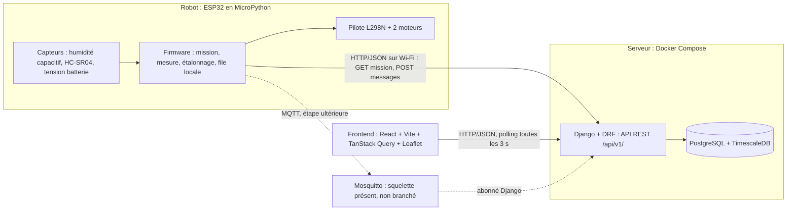
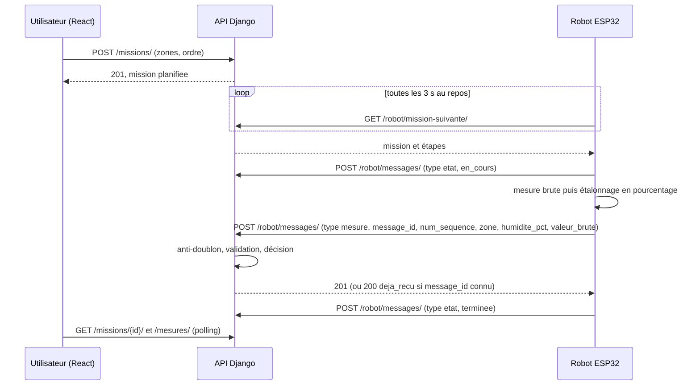

# Architecture matérielle et logicielle — RoboAgri-Kin

> **Version 2** : alignée sur l'arborescence de référence du dépôt et sur les décisions du groupe (un seul robot, étalonnage sur l'ESP32, seuils dans la zone, pas de pompe, anti-doublon par `message_id`).
> **Documents liés** : modèle de données (B), `protocole_communication.md` (E), maquettes (C), `conventions.md`.
> **Priorité en cas de divergence** : pour le *contenu des messages* et les *champs des tables*, le protocole (E) et le modèle de données (B) font foi. Ce document fait foi pour *l'emplacement du code* et les *règles de structure*.

## Sommaire

1. Vue d'ensemble
2. Architecture matérielle
3. Structure du dépôt et couches logicielles
4. Backend : une application Django par module
5. Données : PostgreSQL et TimescaleDB
6. La règle de décision d'irrigation
7. Frontend : pages, composants, appels API
8. Conventions de l'API (URL, réponses, erreurs)
9. Où placer un nouveau fichier ?
10. Risques techniques et mesures
11. Choix technologiques justifiés
12. Plan d'évolution (MQTT et le reste)
13. Cohérence avec B, C, E et points à trancher
14. Historique des versions

---

## 1. Vue d'ensemble

### 1.1 Schéma d'ensemble



Les flèches en pointillés ne sont pas actives dans la version minimale : elles montrent où l'évolution se branchera (section 12).

### 1.2 Cycle de vie d'une mission



### 1.3 Principes directeurs

1. **Le robot exécute et mesure, le serveur valide et décide.** L'ESP32 étalonne sa mesure et envoie le pourcentage **et** la valeur brute (diagnostic). Le serveur contrôle la validité, applique la règle de décision et enregistre. La décision n'est jamais prise sur l'ESP32, car on peut la tester et la corriger sans reflasher.
2. **Un seul robot.** Il n'existe ni entité Robot ni `code_robot` dans les messages. Si un second robot devenait un jour nécessaire, ce serait une évolution de modèle à traiter explicitement (voir 12.2).
3. **Pas de pompe sur le robot.** Le module irrigation produit des *recommandations* ; l'intervention réelle est saisie par l'utilisateur.
4. **Une seule porte d'entrée pour tout ce qui vient du robot** : `communication/handlers.py`. HTTP aujourd'hui, MQTT demain : le transport change, le traitement non.
5. **Les valeurs ne sont jamais perdues.** Une mesure invalide est *enregistrée et marquée invalide*, pas rejetée : c'est la condition de la traçabilité demandée par le sujet.
6. **La version minimale prime.** Ce qui est « plus tard » est préparé par la structure (squelettes, points d'insertion), pas implémenté.

---

## 2. Architecture matérielle

| Bloc | Composants | Rôle |
|---|---|---|
| Contrôleur | ESP32 (MicroPython) | Wi-Fi, lecture des capteurs, étalonnage, pilotage des moteurs |
| Mobilité | Châssis, 2 moteurs, pilote L298N | Avancer, reculer, tourner ; déplacement **par temporisation** (durées fixes, virages chronométrés, pas d'encodeurs) |
| Obstacles | HC-SR04 | Arrêt si distance sous un seuil |
| Humidité | Capteur capacitif analogique | Valeur brute, convertie en pourcentage sur l'ESP32 |
| Énergie | Batterie, régulateur, diviseur de tension vers l'ADC | Alimentation et surveillance du niveau (retour au départ si batterie faible) |
| Réseau | Wi-Fi (partage de connexion d'un téléphone pour la démo) | Liaison robot ↔ serveur |

**Points de câblage à documenter dans le schéma de câblage (livrable 3)** :

- Sur ESP32, le **Wi-Fi bloque l'ADC2** : le capteur d'humidité et la mesure de batterie doivent être branchés sur des broches **ADC1** (GPIO 32 à 39).
- Le **HC-SR04 sort un signal ECHO en 5 V** alors que l'ESP32 est en 3,3 V : prévoir un diviseur de tension.
- Les moteurs provoquent des chutes de tension qui font **redémarrer l'ESP32** (brownout) : alimentation moteurs séparée de celle de l'ESP32 (masses communes), condensateur de découplage, et test dédié.
- Réseau de démo : le backend doit écouter sur `0.0.0.0`, `ALLOWED_HOSTS` doit contenir l'IP du PC, et le pare-feu Windows doit autoriser le port. L'adresse du serveur est dans `firmware/config.py` (copie locale de `config.example.py`), jamais écrite en dur ailleurs.

---

## 3. Structure du dépôt et couches logicielles

### 3.1 Vue d'ensemble du dépôt (mono-repo)

L'arborescence complète fait foi dans le dépôt ; voici le rôle de chaque dossier racine :

| Dossier | Rôle |
|---|---|
| `backend/` | Django + DRF : applications métier, configuration, `core/` partagé, `fixtures/` de démonstration |
| `frontend/` | React + Vite |
| `firmware/` | MicroPython pour l'ESP32 (à plat, un fichier par responsabilité) |
| `mosquitto/` | Configuration du broker (pour l'étape MQTT) |
| `simulateur/` | Simulateur Python du robot, avec scénarios JSON (nominal, perte réseau, capteur défaillant, obstacle) |
| `tests/` | Tests d'intégration de bout en bout (`integration/`) et protocole d'essais |
| `scripts/` | Installation (`setup.sh`, `setup.ps1`), chargement de la démo, sauvegarde |
| `docs/` | Cahier des charges, conception, matériel, tests, expérimentation, rapport LaTeX, suivi |
| `.github/` | CI, modèles de PR et d'issues, `CODEOWNERS` (relecture croisée entre binômes) |

### 3.2 Gabarit d'une application Django

Chaque application suit le même principe. Tous les fichiers ne sont pas présents partout : on ne crée que ce dont l'application a besoin.

```text
backend/apps/<application>/
├── models.py          # tables et contraintes
├── serializers.py     # validation et format JSON (DRF)
├── views.py           # vues MINCES : elles appellent services.py, rien d'autre
├── urls.py
├── services.py        # logique métier avec accès à la base (créer, changer d'état...)
├── <module pur>.py    # fonctions PURES, sans import Django, nommées d'après leur rôle
├── admin.py
├── migrations/
└── tests/             # test_models, test_services, test_<module pur>, test_api
```

**Modules purs** (sans `django`, sans `rest_framework`, sans accès base, sans horloge cachée) : `mesures/validation.py`, `irrigation/decision.py`, `irrigation/securite.py`, `communication/protocole.py`. Ils se testent en une seconde, sans base de données.

**Sens des appels** : `views.py` → `services.py` → `models.py`, et `services.py` → module pur. Jamais l'inverse. Une vue ne contient aucune logique métier.

> **Noms** : les noms imposés par les frameworks (`models.py`, `views.py`, `config/`, `settings/`, `apps/`, `package.json`...) restent tels quels. Le reste suit `conventions.md`. Le dépôt contient quelques noms anglais (`core`, `dashboard`, `handlers`, `run_mqtt`) : voir le point 5 de la section 13.

### 3.3 Règles de dépendance entre applications

Les dépendances ne vont que vers le bas, pour éviter les imports circulaires :

```text
communication     (orchestre : appelle missions, mesures, irrigation)
      │
dashboard         (lecture seule sur tout)
      │
irrigation  ──►  mesures  ──►  missions  ──►  parcelles          (toutes utilisent backend/core/)
```

| Application | A le droit d'importer |
|---|---|
| `core/` (pas une application, aucun modèle) | rien d'autre que Django/DRF |
| `parcelles` | `core` |
| `missions` | `core`, `parcelles` |
| `mesures` | `core`, `parcelles`, `missions` |
| `irrigation` | `core`, `parcelles`, `missions`, `mesures` |
| `dashboard` | toutes, **en lecture seule** (aucune écriture) |
| `communication` | toutes |

Conséquence importante : `mesures` ne sait pas que `irrigation` existe. C'est `communication` qui enchaîne « enregistrer la mesure » puis « évaluer la zone ». Si un import vers le haut semble nécessaire, c'est le signe que le code doit remonter dans `communication/handlers.py`.

**Règle des incidents** : le modèle `Incident` vit dans `irrigation`. **Seuls `irrigation` et `communication` créent des incidents**, via `irrigation.services.signaler_incident(...)`. Les applications `missions` et `mesures` ne les créent pas : elles renvoient un résultat (« mesure invalide », « mission non confirmée ») et c'est l'orchestrateur qui signale.

### 3.4 Firmware

| Fichier | Responsabilité |
|---|---|
| `main.py`, `boot.py` | Démarrage, boucle principale |
| `etat.py` | Machine à états du robot (repos, déplacement, mesure, arrêt obstacle, retour au départ) |
| `moteurs.py`, `navigation.py` | Commande du L298N ; suivi du parcours par temporisation |
| `obstacles.py` | HC-SR04, arrêt immédiat |
| `humidite.py` | Lecture du capteur, **étalonnage brut → pourcentage**, contrôle de plausibilité |
| `batterie.py` | Tension par ADC, déclenchement du retour au départ |
| `reseau.py` | Client HTTP : interroge la mission, envoie les messages |
| `stockage.py` | File d'attente locale, synchronisation différée, **compteur de séquence conservé en mémoire flash** |
| `mqtt_reseau.py` | Client MQTT (squelette) |
| `config.example.py` | Wi-Fi, adresse du serveur, constantes d'étalonnage, seuils de distance ; la copie `config.py` est ignorée par Git |

---

## 4. Backend : une application Django par module

### 4.1 Correspondance modules ↔ applications

| Module du sujet | Application | Contenu principal | Responsables (indicatif) |
|---|---|---|---|
| 1. Parcelles et cultures | `parcelles` | Parcelle, Zone (avec son seuil d'humidité), Culture, association Cultiver | B (modèle, API), C (écrans) |
| 2. Missions du robot | `missions` | Mission, ÉtapeMission, machine d'états (`planifiee`, `en_cours`, `terminee`, `interrompue`, `non_confirmee`) dans `services.py` | B (API), C (écrans) |
| 3. Collecte et mesures | `mesures` | Mesure (hypertable), `validation.py` (plage, cohérence, capteur défaillant) | B (modèle), E (bornes de validité) |
| 4. Irrigation | `irrigation` | Irrigation (recommandations et interventions saisies), Incident, `decision.py`, `securite.py` | E (règle), B (API) |
| 5. Tableau de bord et rapports | `dashboard` | Agrégations Pandas, rapports, export | C |
| *(transverse)* | `communication` | `MessageRecu`, `protocole.py`, `handlers.py`, `api.py`, MQTT (squelette), commandes de surveillance | E (protocole), B (réception) |
| *(partagé)* | `core/` | Permissions, pagination, exceptions métier et gestionnaire d'erreurs | A et B |

### 4.2 Statuts et constantes

Les statuts sont des `TextChoices` placés dans le `models.py` de l'application propriétaire, valeurs en minuscules sans accents :

- Mission : `planifiee`, `en_cours`, `terminee`, `interrompue`, `non_confirmee`.
- État de décision : `suffisante`, `insuffisante`, `invalide`.

Les transitions de mission sont centralisées dans `missions/services.py` ; une transition interdite lève `TransitionInterdite` (section 8.4).

### 4.3 `communication/handlers.py` : l'orchestrateur

C'est le seul endroit qui connaît l'enchaînement complet. La vue HTTP (`api.py`) et l'abonné MQTT (`mqtt_client.py`) appellent la **même** fonction :

```python
def traiter_message(donnees: dict) -> ResultatTraitement:
    """Point d'entrée UNIQUE pour tout message venant du robot (HTTP ou MQTT)."""
    message = protocole.valider(donnees)                 # structure et types (fonction pure)

    # L'unicité est garantie par la contrainte en base, pas par un test préalable :
    # deux envois simultanés du même message ne peuvent pas passer tous les deux.
    try:
        with transaction.atomic():
            enregistre = MessageRecu.objects.create(...)
    except IntegrityError:
        return ResultatTraitement(deja_recu=True, ...)

    if message.type == "mesure":
        mesure = mesures.services.enregistrer_mesure(message, enregistre)   # validation
        irrigation.services.evaluer_zone(mesure)                            # décision, incident
    elif message.type == "etat":
        resultat = missions.services.appliquer_etat_robot(message)
        ...
    elif message.type == "incident":
        irrigation.services.signaler_incident(...)
```

### 4.4 Missions non confirmées et robot hors ligne

`communication/management/commands/detecter_robots_hors_ligne.py` : si aucun message n'est arrivé depuis un délai configurable, le robot est déclaré hors ligne, une mission `en_cours` passe à `non_confirmee` et un incident est signalé (le sujet exige de signaler les missions dont le résultat n'a pas pu être confirmé). Version minimale : commande lancée à la main ou par une tâche planifiée simple. Plus tard : Celery Beat appellera la même fonction (section 12).

---

## 5. Données : PostgreSQL et TimescaleDB

### 5.1 Qui va où

- **Tables classiques** : parcelles, zones, cultures, missions, étapes, irrigations, incidents, messages reçus.
- **Hypertable TimescaleDB** : **les mesures uniquement**, partitionnées sur l'horodatage. Elles sont écrites en continu, lues par plage de temps et agrégées : c'est le cas d'usage de Timescale. Le reste est du relationnel ordinaire.

### 5.2 Précautions propres à une hypertable

1. **Clé primaire** : une hypertable exige que toute contrainte d'unicité contienne la colonne de temps. La migration `mesures/migrations/0002_hypertable.py` (`RunSQL`) remplace la clé primaire par `(id, horodatage)` avant `create_hypertable`. Django continue de voir `id` comme clé primaire.
2. **Pas de clé étrangère *vers* la table des mesures.** Les autres tables ne la référencent pas ; un incident qui concerne une mesure garde `mesure_id` et `horodatage` comme simples champs.
3. **Anti-doublon dans `MessageRecu`**, pas dans les mesures : l'unicité de `message_id` y est possible sans contrainte de temps. Chaque mesure pointe vers son message d'origine, ce qui donne la traçabilité demandée.
4. **Deux informations de temps** : l'ESP32 n'a pas d'horloge fiable sans réseau. Le message porte l'`horodatage` du robot (valable seulement si l'ESP32 est synchronisé par NTP) ; le serveur enregistre en plus l'heure de réception. Cela compte pour la synchronisation différée, où une mesure arrive longtemps après avoir été faite. *(À confirmer avec E, section 13.)*
5. **Valeur brute toujours conservée** à côté du pourcentage : l'étalonnage se faisant sur l'ESP32, le serveur ne peut pas le refaire, mais la valeur brute permet de recalculer hors ligne si les constantes d'étalonnage changent (leur historique est dans `docs/experimentation/etalonnage/`).
6. **Fuseaux** : tout est stocké en UTC (`USE_TZ = True`) ; l'affichage se fait en `Africa/Kinshasa`.

---

## 6. La règle de décision d'irrigation

### 6.1 Où elle vit

| Fichier | Contenu | Pur ? |
|---|---|---|
| `backend/apps/mesures/validation.py` | Contrôle de la mesure reçue : pourcentage entre 0 et 100, valeur brute dans la plage du capteur, valeurs extrêmes qui indiquent un capteur débranché ou en court-circuit, horodatage plausible | oui |
| `backend/apps/irrigation/decision.py` | `decider(...)` : renvoie une `Decision` | oui |
| `backend/apps/irrigation/securite.py` | Conditions de sécurité supplémentaires (voir 6.4) | oui |
| `backend/apps/irrigation/services.py` | Colle : lit la mesure et la zone en base, appelle `decider`, enregistre la recommandation, signale l'incident | non |

L'**étalonnage** (brut → pourcentage) n'est pas dans cette liste : il est fait dans `firmware/humidite.py`.

### 6.2 Contrat de `decider`

```python
@dataclass(frozen=True)
class Decision:
    etat: str               # "suffisante" | "insuffisante" | "invalide"
    arrosage_recommande: bool
    motif: str              # texte lisible, affiché dans l'application et conservé en base
    incident: bool          # True si un incident doit être signalé

def decider(humidite_pct, valide, seuil_min, age_mesure_s, age_max_s) -> Decision:
    # 1. Invalide d'abord : valeur absente, marquée invalide par validation.py, ou trop ancienne
    # 2. Sinon, humidite_pct < seuil_min  -> insuffisante
    # 3. Sinon                            -> suffisante
```

Choix à garder en tête pour la défense :

- **L'invalide est testé en premier**, avant toute comparaison au seuil : une mesure douteuse ne peut jamais produire une recommandation.
- **Comparaison stricte** : à humidité égale au seuil, l'état est `suffisante`. C'est documenté et couvert par un test de valeur limite.
- Le **seuil est un champ de la zone**, saisi dans l'application (B) ; les valeurs viennent des essais (E). `decider` le reçoit en paramètre et ne lit jamais la base.

### 6.3 Tests

`irrigation/tests/test_decision.py` : tests Pytest paramétrés, **sans base de données** :

```text
(humidite 40, seuil 30)                    -> suffisante
(humidite 30, seuil 30)                    -> suffisante   (valeur limite)
(humidite 29.9, seuil 30)                  -> insuffisante
(valide False, n'importe quelle valeur)    -> invalide, incident
(humidite None)                            -> invalide, incident
(mesure plus ancienne que age_max)         -> invalide, incident
```

`mesures/tests/test_validation.py` couvre les bornes de validité. Le test de bout en bout (mission → mesure reçue → mesure enregistrée → recommandation) est dans `tests/integration/test_mission_complete.py`, et les cas dégradés dans `test_perte_communication.py`, `test_mesure_invalide.py` et `test_doublons.py`, joués avec le simulateur.

### 6.4 Pompe et `securite.py`

Le groupe a décidé qu'il n'y a **pas de pompe**. Tant que c'est le cas, `securite.py` ne doit contenir que des conditions utiles à une *recommandation* (mesure récente, batterie suffisante pour la mission). Si une pompe était ajoutée, la durée maximale et les conditions de sécurité iraient dans ce même fichier, avec les mêmes tests, et le firmware garderait une durée maximale codée en dur comme seconde barrière. Les fichiers `firmware/pompe.py` et `securite.py` du dépôt sont donc à marquer « extension, non activée » ou à retirer (section 13).

---

## 7. Frontend : pages, composants, appels API

### 7.1 Organisation (par type de fichier)

```text
frontend/src/
├── main.jsx            # QueryClientProvider, gestionnaire global d'erreurs
├── App.jsx
├── routes.jsx
├── api/                # le SEUL endroit qui sait parler HTTP
│   ├── client.js       # fetch/axios, URL de base, classe ErreurApi
│   └── parcelles.js  missions.js  mesures.js  irrigation.js  dashboard.js
├── hooks/              # TanStack Query : un fichier par module
│   └── useParcelles.js  useMissions.js  useMesures.js  useIrrigation.js
├── pages/              # un écran = un fichier
├── components/         # composants réutilisables ; layout/ pour Navbar et Sidebar
├── utils/              # format.js, constantes.js
├── styles/
└── tests/
```

### 7.2 Règle des trois couches

```text
page  →  hook (hooks/useXxx.js)  →  fonction d'API (api/xxx.js)  →  api/client.js  →  HTTP
```

- Une **page ou un composant n'appelle jamais `fetch`** et ne connaît aucune URL.
- Chaque fichier de `api/` contient de simples fonctions (`listerMissions(filtres)`, `creerMission(donnees)`).
- Chaque fichier de `hooks/` enveloppe ces fonctions avec TanStack Query (`useMissions`, `useMission`, `useCreerMission`...).
- Si l'URL d'une route change, une seule ligne change, dans un seul fichier de `api/`.

### 7.3 Pages

> Le tableau fixe l'**emplacement** ; les maquettes de C fixent le **contenu**.

| Page | Module | Composants principaux |
|---|---|---|
| `Accueil.jsx` | — | `EtatRobot`, résumé |
| `Parcelles.jsx`, `DetailParcelle.jsx` | Parcelles | `CarteParcelle` (Leaflet), `FormulaireZone`, `TableauDonnees` |
| `Missions.jsx`, `DetailMission.jsx` | Missions | `FormulaireMission`, `EtatMission` (suivi en direct) |
| `Mesures.jsx` | Mesures | `GraphiqueHumidite`, `TableauDonnees` |
| `Irrigation.jsx`, `Incidents.jsx` | Irrigation | recommandations, saisie d'une intervention, liste des incidents |
| `Dashboard.jsx`, `Rapports.jsx` | Tableau de bord | `ComparaisonZones`, `GraphiqueHumidite` |

### 7.4 TanStack Query : conventions

- **Clés de requête** définies en haut de chaque fichier de `hooks/` dans un objet `cles`, jamais écrites à la main dans les pages : `['missions', 'liste', filtres]`, `['missions', 'detail', id]`.
- **Polling** : `refetchInterval` de 3 s **uniquement** quand la donnée peut changer (mission `en_cours`, page ouverte). Sinon, pas de polling.

```js
// hooks/useMissions.js
const cles = {
  liste: (filtres) => ["missions", "liste", filtres],
  detail: (id) => ["missions", "detail", id],
};

export function useMission(id) {
  return useQuery({
    queryKey: cles.detail(id),
    queryFn: () => obtenirMission(id),
    refetchInterval: (requete) =>
      requete.state.data?.statut === "en_cours" ? 3000 : false,
  });
}
```

- **Mutations** : après chaque création ou modification, `invalidateQueries` sur la clé du module concerné ; pas de mise à jour manuelle du cache.
- **Erreurs** : `api/client.js` transforme toute réponse d'erreur en `ErreurApi` (code, message, détails). Un gestionnaire global (`QueryCache`, dans `main.jsx`) affiche le message ; les erreurs de champ (`DONNEES_INVALIDES`) s'affichent sous les champs du formulaire.
- **Pas d'état global maison** : les données du serveur vivent dans le cache TanStack Query, l'état purement visuel dans les composants.
- **Quand `components/` grossit** : ranger par module dans des sous-dossiers (`components/missions/`...) plutôt que de laisser un dossier plat de plus de 15 fichiers.

---

## 8. Conventions de l'API

Les valeurs ci-dessous sont **provisoires** pour la partie `/robot/` jusqu'à validation de `protocole_communication.md`.

### 8.1 Routes

Préfixe `/api/v1/`, noms de ressources au pluriel, en français sans accents.

| Ressource | Routes |
|---|---|
| Parcelles, zones, cultures | `/parcelles/`, `/zones/`, `/cultures/` (CRUD) |
| Missions | `/missions/` (création, liste), `/missions/{id}/` (détail), `/missions/{id}/interrompre/` |
| Mesures | `/mesures/?zone=&du=&au=` (lecture seule côté utilisateur) |
| Irrigation | `/irrigations/` (recommandations et interventions), `/incidents/` |
| Tableau de bord | `/dashboard/synthese/`, `/dashboard/series/`, `/dashboard/rapports/` |
| **Robot** | `GET /robot/mission-suivante/`, `POST /robot/messages/` |

Un **seul** `POST /robot/messages/` accepte tous les types de messages (`mesure`, `etat`, `incident`), distingués par le champ `type`. Le jour où MQTT arrive, il transportera exactement le même JSON.

### 8.2 Format des réponses

- **Succès** : la ressource directement, sans enveloppe. Codes `200`, `201`, `204`.
- **Listes** : pagination DRF standard `{ "count", "next", "previous", "results" }`, 50 éléments par défaut (`core/pagination.py`).
- **Dates** : ISO 8601 avec fuseau (`2026-11-03T08:15:00Z`).
- **Clés JSON** : identiques aux noms de champs (`snake_case`, français, sans accents).
- **Message robot déjà reçu** : `200` avec `"deja_recu": true` et les identifiants de ce qui avait été créé la première fois ; rien n'est réenregistré.
- **Mesure invalide** : `201`, la mesure est enregistrée avec `"valide": false` et un incident est créé. Une mesure invalide n'est pas une erreur de requête.

### 8.3 Format des erreurs

Une seule forme, produite par un gestionnaire d'exceptions unique (`backend/core/exceptions.py`, branché sur le réglage DRF `EXCEPTION_HANDLER`) :

```json
{
  "erreur": {
    "code": "TRANSITION_INTERDITE",
    "message": "Une mission terminée ne peut pas repasser en cours.",
    "details": { "statut_actuel": "terminee" }
  }
}
```

| Situation | HTTP | `code` |
|---|---|---|
| Champ manquant ou invalide | 400 | `DONNEES_INVALIDES` (détails par champ) |
| Non authentifié | 401 | `NON_AUTHENTIFIE` |
| Droit insuffisant | 403 | `ACCES_REFUSE` |
| Ressource inexistante | 404 | `RESSOURCE_INTROUVABLE` |
| Transition d'état interdite, conflit | 409 | `TRANSITION_INTERDITE`, `CONFLIT` |
| Erreur imprévue | 500 | `ERREUR_INTERNE` (aucun détail technique renvoyé) |

### 8.4 Gestion des erreurs dans le code

- Les services lèvent des **exceptions métier** définies dans `core/exceptions.py` (`ErreurMetier` et ses sous-classes `TransitionInterdite`, `RessourceIntrouvable`...).
- **Aucun `try/except` dans les vues** : le gestionnaire central transforme l'exception en réponse.
- On n'avale jamais une exception sans la journaliser ; les erreurs imprévues sont enregistrées avec `logging`, pas avec `print`.

### 8.5 Authentification

- **Utilisateurs** : jeton DRF (`rest_framework.authtoken`) ou session, à trancher par B et C ; permissions dans `core/permissions.py`.
- **Robot** : clé secrète dans un en-tête (`X-Cle-Robot`), lue depuis une variable d'environnement côté serveur (`.env`) et depuis `config.py` côté firmware. Elle ne figure jamais dans Git.
- `django-cors-headers` : uniquement l'origine du frontend de développement autorisée.

---

## 9. Où placer un nouveau fichier ?

| Je veux ajouter... | Je le mets dans... |
|---|---|
| Un nouveau champ ou une nouvelle table | `models.py` de l'application propriétaire, puis `makemigrations` |
| Une règle de calcul ou de décision (sans accès base) | Un module pur nommé d'après son rôle dans l'application (`decision.py`, `validation.py`...), avec son `test_<nom>.py` |
| Une opération métier qui lit ou écrit en base | `services.py` de l'application |
| Un point d'API utilisateur | `serializers.py` + `views.py` + `urls.py` de l'application (vue mince : elle appelle un service) |
| Un point d'API pour le robot | `communication/api.py`, qui appelle `handlers.py` |
| Un enchaînement qui touche plusieurs modules | `communication/handlers.py` ; son test dans `tests/integration/` |
| Une exception métier, une permission, un réglage de pagination | `backend/core/` |
| Une commande de maintenance | `<application>/management/commands/` |
| Un test sans base | `<application>/tests/test_<module pur>.py` |
| Un test qui traverse plusieurs applications | `tests/integration/` (à la racine) |
| Des données de démonstration | `backend/fixtures/` |
| Un nouvel écran | `frontend/src/pages/` |
| Un composant | `frontend/src/components/` |
| Un appel à l'API | `frontend/src/api/<module>.js` + son hook dans `frontend/src/hooks/` |
| Du code du robot | `firmware/`, un fichier par responsabilité (section 3.4) |
| Une constante propre au robot (Wi-Fi, seuils de distance, étalonnage) | `firmware/config.py` (modèle : `config.example.py`) |
| Un secret (clé, mot de passe Wi-Fi) | `.env` ou `firmware/config.py`, **ignorés par Git**, avec un fichier `*.example` versionné |
| Un scénario de simulation | `simulateur/scenarios/` |
| Un diagramme ou un document de conception | `docs/conception/` |
| Un relevé d'étalonnage | `docs/experimentation/etalonnage/` |
| Un script d'aide | `scripts/` |

**Règle de secours** : si aucune ligne ne convient, ne créez pas un dossier « divers » ; ouvrez une discussion avec A, et mettez à jour ce tableau.

---

## 10. Risques techniques et mesures

| Risque | Mesure d'architecture |
|---|---|
| Erreur de mesure, capteur défaillant | Contrôle de plausibilité sur l'ESP32 (`humidite.py`) puis `validation.py` côté serveur ; mesure conservée mais `valide: false` ; décision `invalide` ; incident ; jamais de recommandation |
| Interruption de communication | File locale sur l'ESP32 (`stockage.py`), renvoi du même message, anti-doublon serveur, détection robot hors ligne et missions `non_confirmee` |
| Message envoyé deux fois | Unicité de `message_id` dans `MessageRecu`, garantie par contrainte en base ; réponse `deja_recu`, pas de second enregistrement |
| Compteur de séquence remis à zéro par un redémarrage | Compteur conservé en flash (`stockage.py`) ; sinon un message neuf serait pris pour un doublon, ou l'inverse |
| Alimentation (batterie faible, chutes moteurs) | Lecture de la tension par ADC (`batterie.py`), retour au point de départ sous un seuil, alimentation moteurs séparée, test dédié |
| Obstacle | Arrêt immédiat dans la boucle de déplacement, avant toute autre tâche, incident enregistré |
| Arrosage incontrôlé | Pas de pompe : le système ne peut produire que des recommandations |
| Régression entre modules | Tests par module, tests d'intégration, simulateur de robot, CI sur chaque PR |

---

## 11. Choix technologiques justifiés

| Choix | Pourquoi | Alternative écartée | Limite assumée |
|---|---|---|---|
| **Django + DRF** | Recommandé par le sujet ; ORM, migrations, admin utilisable dès la semaine 4 pour saisir des données de test ; DRF fournit sérialisation et validation | Flask/FastAPI : plus de code à écrire nous-mêmes pour la même chose | Plus lourd qu'un micro-framework |
| **PostgreSQL + TimescaleDB** | Mesures = série temporelle (écriture continue, requêtes par période, agrégats) ; Timescale reste du PostgreSQL, donc relationnel et séries partagent une seule base | SQLite seul : accepté par le sujet, mais pas de partitionnement ni d'agrégats temporels | Contraintes sur les clés de l'hypertable (5.2) ; plus lourd à installer, d'où Docker |
| **React + Vite + TanStack Query** | Les données changent en continu (mission en cours, nouvelles mesures) : TanStack Query gère cache, polling et invalidation sans code maison | Templates Django : le rafraîchissement continu serait plus laborieux | Deux projets à lancer ; plus à apprendre |
| **Frontend organisé par type de fichier** (`api/`, `hooks/`, `pages/`, `components/`) | Simple à expliquer et à retrouver pour des débutants : un nom de dossier = un rôle | Organisation par module : plus évolutive mais plus abstraite | À grande taille, `components/` demande des sous-dossiers (7.4) |
| **Polling de 3 s avant WebSocket** | Simple, déboguable, suffisant pour un robot lent | Channels + Redis dès le départ : deux services de plus à maîtriser | Quelques secondes de latence, requêtes répétées |
| **HTTP avant MQTT** | Le robot interroge le serveur : pas de broker à installer, testable avec un navigateur ou `curl` | MQTT dès le départ | Moins adapté à la poussée de commandes ; migration prévue (section 12) |
| **Robot en « pull » de mission** | Le robot n'a pas besoin d'être joignable : pas de problème de pare-feu ni d'IP côté ESP32 | Serveur qui appelle le robot | Délai de prise en charge (≤ 3 s) |
| **Un seul robot, pas d'entité Robot** | Le projet n'en a qu'un ; le modèle reste simple | Entité Robot et `code_robot` partout | Un second robot demanderait une évolution du modèle et du protocole (12.2) |
| **ESP32 en MicroPython** | Même langage que le reste de l'équipe, itération rapide, REPL pour déboguer | C++/Arduino : plus performant | Moins rapide ; le C++ reste possible pour une partie critique |
| **Étalonnage sur l'ESP32, valeur brute envoyée aussi** | Le robot transmet une valeur directement exploitable ; la valeur brute reste disponible pour le diagnostic et un recalcul hors ligne | Conversion côté serveur avec entité de calibrage | Changer l'étalonnage oblige à reflasher l'ESP32 ; le serveur ne peut pas vérifier l'étalonnage utilisé, seulement la plausibilité |
| **Décision d'arrosage sur le serveur, en fonction pure** | Testable sans base ni matériel, défendable ligne par ligne, modifiable sans reflasher | Logique dans les vues, les signaux Django ou sur l'ESP32 | Un fichier de plus à maintenir |
| **Déplacement par temporisation** | Pas d'encodeurs : budget et câblage réduits | Encodeurs, suivi de ligne | Dérive avec la batterie et le sol : parcours court, essais répétés, limites écrites dans le rapport |
| **Docker Compose** | Même environnement pour dix machines Windows ; Timescale sans installation manuelle | Installation locale de chaque service | Docker Desktop + WSL2 est gourmand ; tous les PC ne le supportent pas |
| **Mono-repo** | Un seul dépôt, une PR peut toucher API et frontend, historique unique des contributions | Deux dépôts | Dossiers à bien séparer (c'est le rôle de ce document) |
| **Pytest + simulateur de robot** | Les tests ne dépendent pas du matériel ; contributions individuelles vérifiables | Tests manuels uniquement | Le simulateur ne remplace pas les essais réels |
| **Pandas** | Calcul des indicateurs et exports des rapports (`dashboard/services.py`, `rapports.py`) | Boucles Python à la main | Pas pour les gros agrégats : ceux-ci passent par SQL (`time_bucket`) |
| **Plotly ou Recharts** | Exigence du sujet : graphiques exploitables | — | **À trancher par C avant la semaine 6** ; l'usage reste dans `GraphiqueHumidite.jsx` et `ComparaisonZones.jsx` pour que le changement soit local |

---

## 12. Plan d'évolution

Principe : **MQTT est conçu dès maintenant, implémenté après la version de base**. Les squelettes existent dans le dépôt ; la version minimale n'en dépend pas.

### 12.1 Pourquoi l'ajout de MQTT est localisé

Tout ce qui vient du robot passe par `communication/handlers.traiter_message`. La vue HTTP en est un *adaptateur* ; l'abonné MQTT en sera un second.

```text
Aujourd'hui :  robot --HTTP--> communication/api.py ---------------> handlers.traiter_message()
Demain      :  robot --MQTT--> mosquitto --> mqtt_client.py -------> handlers.traiter_message()  (même fonction)
```

| Élément | État actuel | Reste à faire |
|---|---|---|
| `mosquitto/` (configuration, README) | présent | Ajouter le service dans `docker-compose.yml`, dans un profil optionnel |
| `communication/mqtt_client.py` | squelette | Abonné (paho-mqtt) : décode le JSON, appelle `traiter_message` |
| `communication/management/commands/run_mqtt.py` | squelette | Lance l'abonné |
| `firmware/mqtt_reseau.py`, `firmware/lib/umqtt/` | squelette | Même interface que `reseau.py` |
| `firmware/config.example.py` | à compléter | Réglage `TRANSPORT = "http"` ou `"mqtt"` |

Les squelettes **lèvent explicitement `NotImplementedError`** et sont décrits comme tels dans leur README : ainsi personne ne croit que MQTT fonctionne, et personne ne s'étonne de ces fichiers à la défense.

Ce qui **ne change pas** : modèles, services, modules purs, frontend, format JSON des messages, anti-doublon par `message_id`.

**Sujets MQTT** (à figer avec E) : un sujet pour la mission (serveur → robot), un pour les mesures, un pour les états (robot → serveur), avec les mêmes champs que le message HTTP. MQTT pouvant livrer un message deux fois, l'idempotence par `message_id` reste indispensable.

### 12.2 Autres extensions prévues

| Évolution | Point d'insertion | Ce qui reste intact |
|---|---|---|
| **WebSocket (Channels + Redis)** | Un consommateur notifie le frontend après `traiter_message` ; côté React, le hook invalide le cache à la réception au lieu de `refetchInterval` | Pages, composants, API REST (qui reste la source de vérité) |
| **Celery** | Les tâches appellent les fonctions existantes (détection des robots hors ligne, rapports périodiques) | Aucune logique à réécrire |
| **Prédiction (scikit-learn)** | Nouvelle application `prediction/`, au-dessus de `mesures` ; ses sorties deviennent des recommandations de source différente | `decision.py` (la règle par seuil reste la référence) |
| **Comparaison arrosage systématique vs guidé** | Agrégations ajoutées dans `dashboard/services.py` à partir des interventions saisies | Modèles existants |
| **Navigation autonome** | Évolution de `firmware/navigation.py` et de l'état du robot ; aucun changement de l'API | Tout le reste |
| **Pompe** | Section 6.4 : sécurités dans `securite.py` + commande dans le protocole | Tout le reste |
| **Second robot** | Ajout d'une entité Robot et d'un identifiant dans les messages et dans `MessageRecu` | Applications et frontend, avec adaptation des vues |
| **CI** | Workflows `backend-ci.yml` et `frontend-ci.yml` déjà présents ; à compléter progressivement (Pytest, lint, build) | Aucun code applicatif |
| **Synchronisation différée** | Prévue dans la version de base : `stockage.py` + `message_id` + `horodatage` | — |

---

## 13. Cohérence avec B, C, E et points à trancher

### 13.1 Ce que ce document suppose

| Source | Hypothèse reprise ici |
|---|---|
| **Modèle de données (B)** | Pas d'entité Robot ni `code_robot` ; association Cultiver entre Zone et Culture ; seuil d'humidité dans Zone ; pas d'entité Calibrage ; `MessageRecu` avec `message_id` unique ; Incident rattaché au module irrigation |
| **Protocole (E)** | Champs du message : `message_id`, `num_sequence`, mission, zone, pourcentage étalonné, valeur brute, horodatage, type, état ; un message déjà reçu renvoie la même réponse sans second enregistrement ; HTTP d'abord, robot en pull de mission |
| **Maquettes (C)** | Une page par fonctionnalité des cinq modules ; suivi de mission en direct ; carte Leaflet de la parcelle |

### 13.2 Écarts à fermer avant le gel de ce document

À partir de la comparaison avec l'arborescence du dépôt :

1. **Clé anti-doublon : `message_id` ou `num_sequence` ?** Les deux apparaissent dans les décisions. Ce document retient `message_id` (unique) pour le doublon et `num_sequence` pour l'ordre. **Si `message_id` est fabriqué à partir d'un compteur sur l'ESP32, ce compteur doit survivre aux redémarrages** (conservé en flash, `stockage.py`). *(E et B.)*
2. **`mesures/etalonnage.py`** est dans le dépôt alors que l'étalonnage est fait sur l'ESP32 et que l'entité Calibrage a été supprimée. Proposition : retirer le fichier et son test `test_etalonnage.py`, et faire porter l'étalonnage par `firmware/humidite.py`. *(B et E.)*
3. **Modèle `Seuil`** dans `irrigation/models.py`, alors que les seuils sont un champ de la zone. Proposition : le retirer. *(B.)*
4. **`firmware/pompe.py` et `irrigation/securite.py`** supposent une pompe, qui est écartée. Soit on les marque « extension, non activée » (6.4), soit on les retire. Le critère RF08 du sujet (limite de fonctionnement de la pompe) est sans objet sans pompe : cela doit être dit dans le rapport. *(E, A.)*
5. **Noms anglais** (`core`, `dashboard`, `handlers`, `run_mqtt`, `services`) alors que `conventions.md` impose le français sans accents. Soit on les garde et on ajoute une exception à `conventions.md` (« noms de structure Django usuels »), soit on les renomme (`noyau`, `tableau_bord`...). *(A.)*
6. **Fichiers manquants dans l'arborescence** :
   - `services.py` dans `mesures/` et `irrigation/` (les fonctions `enregistrer_mesure`, `evaluer_zone`, `signaler_incident` n'ont pas de place) ;
   - `hooks/useDashboard.js` (le fichier `api/dashboard.js` existe sans hook) ;
   - un dossier `docs/conception/maquettes/` ;
   - `conventions.md`, `CONTRIBUTING.md` et `ATELIER_GIT.md` à la racine.
7. **Doublon possible** entre `tests/protocole_essais.md` et `docs/tests/dossier_de_tests.md` : définir lequel contient les fiches et lequel est la synthèse.
8. **Horloge de l'ESP32** : a-t-il une heure fiable (NTP) quand il envoie en différé ? Sinon, que contient `horodatage` ? *(E.)*
9. **Authentification des utilisateurs** : jeton ou session. *(B et C.)*
10. **Bibliothèque de graphiques** : Plotly ou Recharts. *(C.)*

### 13.3 Mise à jour du document

Toute modification de structure (nouvelle application, nouveau dossier racine, nouvelle règle de dépendance) passe par une PR qui **modifie aussi ce fichier** ; la relecture est faite par un autre binôme que l'auteur.

---

## 14. Historique des versions

| Version | Changement |
|---|---|
| 1 | Première rédaction |
| 2 | Alignement sur l'arborescence de référence du dépôt (noms `config`, `apps`, `core`, `dashboard`, `handlers`, modules purs `decision.py` et `validation.py`, frontend par type de fichier, firmware à plat, squelettes MQTT, `tests/integration/` à la racine). Alignement sur les décisions de groupe : un seul robot (plus de `code_robot`), étalonnage sur l'ESP32, pas d'entité Calibrage, anti-doublon par `message_id`, pas de pompe. Ajout de la liste des écarts à trancher (13.2) |