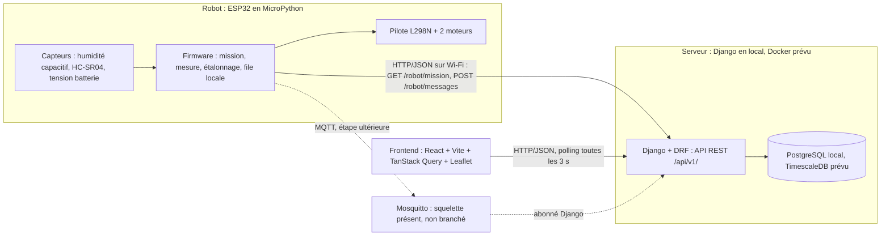
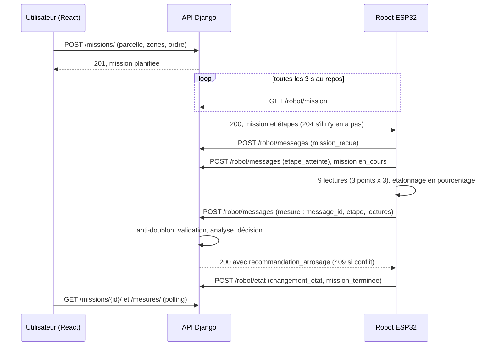

# Architecture matérielle et logicielle — RoboAgri-Kin

> **Version 4** (14 novembre 2026) : alignée sur le code réellement écrit. Les tables suivent le modèle de données (MPD) : utilisateur personnalisé, `Message`, `Mesure` (9 par étape), `Analyse`, `Decision`, `Irrigation`, `Incident`. Les applications `incidents` et `analyse` sont séparées. Les tests sont centralisés dans `backend/tests/`. La communication robot est adaptée au MPD. PostgreSQL tourne en local : Docker et TimescaleDB ne sont pas encore en place. **L'état de chaque module est dans la section 15.**
> **Documents liés** : modèle de données (B, MPD), `protocole-communication.md` (E), maquettes (C), `conventions.md`, `backend/README.md`, `docs/api-frontend-backend.md`.
> **Priorité en cas de divergence** :
> 1. le **modèle de données (MPD)** fait foi pour les tables, les champs, les contraintes et les règles de gestion (RG) ;
> 2. le **protocole** a été conçu avant le MPD : on n'en reprend que ce que le MPD ne couvre pas (adresses du robot, authentification, réponses, codes d'erreur, comportement en cas de doublon) ;
> 3. ce document fait foi pour l'*emplacement du code* et les *règles de structure*.

## Sommaire

1. Vue d'ensemble
2. Architecture matérielle
3. Structure du dépôt et couches logicielles
4. Backend : une application Django par module
5. Données : PostgreSQL et TimescaleDB
6. La règle de décision d'irrigation
7. Frontend : pages, composants, appels API
8. Conventions de l'API (URL, réponses, erreurs)
9. Où placer un nouveau fichier ?
10. Risques techniques et mesures
11. Choix technologiques justifiés
12. Plan d'évolution (MQTT et le reste)
13. Cohérence avec B, C, E et points à trancher
14. Historique des versions
15. État d'avancement

---

## 1. Vue d'ensemble

### 1.1 Schéma d'ensemble



Les flèches en pointillés ne sont pas actives dans la version minimale : elles montrent où l'évolution se branchera (section 12).

### 1.2 Cycle de vie d'une mission



### 1.3 Principes directeurs

1. **Le robot exécute et mesure, le serveur valide et décide.** L'ESP32 étalonne ses lectures et envoie le pourcentage **et** la valeur brute (diagnostic). Le serveur contrôle la validité, calcule l'analyse de la zone, applique la règle de décision et enregistre. La décision n'est jamais prise sur l'ESP32, car on peut la tester et la corriger sans reflasher.
2. **Un seul robot.** Il n'existe ni entité Robot ni `code_robot` dans les messages. Si un second robot devenait nécessaire, ce serait une évolution de modèle à traiter explicitement (voir 12.2).
3. **Pas de pompe sur le robot.** Le module irrigation produit des *recommandations* ; l'intervention réelle est saisie par l'utilisateur. Le MPD garde pourtant l'irrigation automatique (`automatique`, `irrigation_auto_active`, RG15) : ces champs sont **réservés à l'extension « pompe »** et ne sont jamais déclenchés en réel aujourd'hui.
4. **Une seule porte d'entrée pour tout ce qui vient du robot** : `communication/traitement.py`. HTTP aujourd'hui, MQTT demain : le transport change, le traitement non.
5. **Les valeurs ne sont jamais perdues.** Une lecture invalide est *enregistrée avec le statut `invalide`*, pas rejetée : c'est la condition de la traçabilité demandée par le sujet.
6. **La version minimale prime.** Ce qui est « plus tard » est préparé par la structure (squelettes, points d'insertion), pas implémenté.
7. **Le MPD est la référence des données.** Une règle de gestion qui ne peut pas s'exprimer en base (par exemple RG5) est contrôlée dans le code et testée.

---

## 2. Architecture matérielle

| Bloc | Composants | Rôle |
|---|---|---|
| Contrôleur | ESP32 (MicroPython) | Wi-Fi, lecture des capteurs, étalonnage, pilotage des moteurs |
| Mobilité | Châssis, 2 moteurs, pilote L298N | Avancer, reculer, tourner ; déplacement **par temporisation** (durées fixes, virages chronométrés, pas d'encodeurs) |
| Obstacles | HC-SR04 | Arrêt si distance sous un seuil |
| Humidité | Capteur capacitif analogique | Valeur brute, convertie en pourcentage sur l'ESP32 |
| Énergie | Batterie, régulateur, diviseur de tension vers l'ADC | Alimentation et surveillance du niveau (retour au départ si batterie faible) |
| Réseau | Wi-Fi (partage de connexion d'un téléphone pour la démo) | Liaison robot ↔ serveur |

**Points de câblage à documenter dans le schéma de câblage (livrable 3)** :

- Sur ESP32, le **Wi-Fi bloque l'ADC2** : le capteur d'humidité et la mesure de batterie doivent être branchés sur des broches **ADC1** (GPIO 32 à 39).
- Le **HC-SR04 sort un signal ECHO en 5 V** alors que l'ESP32 est en 3,3 V : prévoir un diviseur de tension.
- Les moteurs provoquent des chutes de tension qui font **redémarrer l'ESP32** (brownout) : alimentation moteurs séparée de celle de l'ESP32 (masses communes), condensateur de découplage, et test dédié.
- Réseau de démo : le backend doit écouter sur `0.0.0.0`, `ALLOWED_HOSTS` doit contenir l'IP du PC, et le pare-feu Windows doit autoriser le port. L'adresse du serveur est dans `firmware/config.py` (copie locale de `config.example.py`), jamais écrite en dur ailleurs.

---

## 3. Structure du dépôt et couches logicielles

### 3.1 Vue d'ensemble du dépôt (mono-repo)

L'arborescence complète fait foi dans le dépôt ; voici le rôle de chaque dossier racine :

| Dossier | Rôle |
|---|---|
| `backend/` | Django + DRF : applications métier (`apps/`), configuration (`config/`), `core/` partagé, **`tests/`** (tous les tests du backend), `donnees_demo.py` (base de démonstration), `.env.example`, `requirements.txt`, `pytest.ini`, `conftest.py`, `README.md` |
| `frontend/` | React + Vite |
| `firmware/` | MicroPython pour l'ESP32 (à plat, un fichier par responsabilité) |
| `mosquitto/` | Configuration du broker (pour l'étape MQTT) |
| `simulateur/` | Simulateur Python du robot, avec scénarios JSON (nominal, perte réseau, capteur défaillant, obstacle) |
| `tests/` | Tests d'intégration de bout en bout (`integration/`) et protocole d'essais |
| `scripts/` | Installation (`setup.sh`, `setup.ps1`), sauvegarde |
| `docs/` | Cahier des charges, conception, matériel, tests, expérimentation, rapport LaTeX, suivi |
| `.github/` | CI, modèles de PR et d'issues, `CODEOWNERS` (relecture croisée entre binômes) |

### 3.2 Gabarit d'une application Django

Chaque application suit le même principe. Tous les fichiers ne sont pas présents partout : on ne crée que ce dont l'application a besoin.

```text
backend/apps/<application>/
├── models.py          # tables et contraintes (conformes au MPD)
├── admin.py           # saisie et vérification des données
├── serializers.py     # validation et format JSON (DRF)
├── views.py           # vues MINCES : elles appellent services.py, rien d'autre
├── urls.py
├── services.py        # logique métier avec accès à la base (créer, changer d'état, lister)
├── <module pur>.py    # fonctions PURES, sans import Django, nommées d'après leur rôle
└── migrations/

backend/tests/<application>/     # test_modeles, test_api, test_services, test_<module pur>
backend/conftest.py              # fixtures partagées (utilisateur, parcelle, zones, client API)
backend/pytest.ini               # DJANGO_SETTINGS_MODULE, testpaths = tests
```

**Pourquoi les tests sont centralisés dans `backend/tests/`** : le dossier de tests est un livrable, il se présente et se compte en un seul endroit, le binôme qui coordonne les tests voit tout d'un coup d'œil, et `pytest` lance tout sans configuration. Chaque sous-dossier contient un `__init__.py` (sinon deux fichiers `test_api.py` entrent en conflit). Règle d'équipe : **un module livré arrive avec ses tests, dans la même PR**.

**Modules purs** (sans `django`, sans `rest_framework`, sans accès base, sans horloge cachée) : `mesures/validation.py`, `irrigation/decision.py`, `irrigation/securite.py`, `communication/protocole.py`. Ils se testent en une seconde, sans base de données.

**Sens des appels** : `views.py` → `services.py` → `models.py`, et `services.py` → module pur. Jamais l'inverse. Une vue ne contient aucune logique métier.

> **Noms** : les noms imposés par les frameworks (`models.py`, `views.py`, `config/`, `settings/`, `apps/`, `package.json`...) restent tels quels. Le reste suit `conventions.md` (français sans accents). Le dépôt contient quelques noms anglais (`core`, `dashboard`, `services`, `run_mqtt`) : voir le point 5 de la section 13. Les champs imposés par Django sur le modèle utilisateur (`password`, `is_active`, `is_staff`) restent en anglais ; la colonne SQL du mot de passe s'appelle bien `mot_de_passe`.

### 3.3 Règles de dépendance entre applications

Les dépendances ne vont que vers le bas, pour éviter les imports circulaires :

```text
communication       (orchestre : appelle toutes les autres)
dashboard           (lecture seule sur tout)
      │
irrigation  ──►  analyse  ──►  mesures  ──►  missions  ──►  parcelles
                                                 ▲
                                             incidents          (toutes utilisent core/)
```

| Application | A le droit d'importer |
|---|---|
| `core/` (pas une application, aucun modèle) | rien d'autre que Django/DRF |
| `utilisateurs` | `core` |
| `parcelles` | `core` (le propriétaire est lié par `settings.AUTH_USER_MODEL`) |
| `missions` | `core`, `parcelles` |
| `incidents` | `core`, `missions` |
| `mesures` | `core`, `parcelles`, `missions` |
| `analyse` | `core`, `parcelles`, `mesures` |
| `irrigation` | `core`, `parcelles`, `mesures`, `analyse`, `incidents` |
| `dashboard` | toutes, **en lecture seule** (aucune écriture) |
| `communication` | toutes |

**Clés étrangères entre applications : par chaîne**, jamais par import (`"missions.Mission"`, `"parcelles.Zone"`, `"incidents.Incident"`, `"analyse.Analyse"`, `"communication.Message"`). `Mesure` référence ainsi des tables d'applications qu'elle n'importe pas, et on évite les imports circulaires à la création des applications.

Conséquence importante : `mesures` ne sait pas que `irrigation` existe. C'est `communication` qui enchaîne « enregistrer les mesures », « calculer l'analyse », « décider ». Si un import vers le haut semble nécessaire, c'est le signe que le code doit remonter dans `communication/traitement.py`.

**Règle des incidents** : le modèle `Incident` vit dans l'application `incidents`. **Seuls `communication` et `irrigation` créent des incidents**, via `incidents.services.signaler_incident(...)`. Les applications `missions` et `mesures` ne les créent pas : elles renvoient un résultat (« lecture invalide », « mission non confirmée ») et c'est l'orchestrateur qui signale.

### 3.4 Firmware

| Fichier | Responsabilité |
|---|---|
| `main.py`, `boot.py` | Démarrage, boucle principale |
| `etat.py` | Machine à états du robot (repos, déplacement, mesure, arrêt obstacle, retour au départ) |
| `moteurs.py`, `navigation.py` | Commande du L298N ; suivi du parcours par temporisation |
| `obstacles.py` | HC-SR04, arrêt immédiat |
| `humidite.py` | Lecture du capteur, **étalonnage brut → pourcentage**, contrôle de plausibilité |
| `batterie.py` | Tension par ADC, déclenchement du retour au départ |
| `reseau.py` | Client HTTP : interroge la mission, envoie les messages |
| `stockage.py` | File d'attente locale, synchronisation différée, **compteur de séquence conservé en mémoire flash** |
| `mqtt_reseau.py` | Client MQTT (squelette) |
| `config.example.py` | Wi-Fi, adresse du serveur, jeton du robot, constantes d'étalonnage, seuils de distance ; la copie `config.py` est ignorée par Git |

---

## 4. Backend : une application Django par module

### 4.1 Correspondance modules ↔ applications

| Module du sujet | Application | Contenu principal | Responsables (indicatif) |
|---|---|---|---|
| *(transverse)* | `utilisateurs` | `Utilisateur` personnalisé (connexion par e-mail, rôle `administrateur` ou `proprietaire`, mot de passe haché) | B |
| *(transverse)* | `auth` | Vues JWT : connexion, rafraîchissement, `moi` (GET, PATCH). Aucun modèle | B |
| 1. Parcelles et cultures | `parcelles` | `Parcelle`, `Zone` (`humidite_minimum`, `humidite_maximum`, `geometrie_zone`, `irrigation_auto_active`), `Culture`, `Cultiver` | B (modèle, API), C (écrans) |
| 2. Missions du robot | `missions` | `Mission`, `Etape` ; états ; actions `demarrer`, `terminer`, `interrompre` ; règle RG5 dans le serializer | B (API), C (écrans) |
| 3. Collecte et mesures | `mesures` | `Mesure` (9 par étape : 3 points × 3 lectures), `validation.py` (plage, cohérence, capteur défaillant) | B (modèle), E (bornes de validité) |
| *(transverse)* | `communication` | `Message` (clé primaire `message_id`), `traitement.py`, `api.py` ou vues robot, MQTT (squelette), commandes de surveillance | E (protocole), B (réception) |
| *(ajouté)* | `analyse` | `Analyse` (synthèse des mesures valides d'une zone) ; plus tard prédiction et comparaison arrosage systématique / guidé | E, B |
| 4. Irrigation | `irrigation` | `Decision`, `Irrigation` (interventions saisies), `decision.py`, `securite.py` | E (règle), B (API) |
| *(ajouté)* | `incidents` | `Incident` (`obstacle`, `capteur_defaillant`, `perte_communication`, `mesure_invalide`) | B |
| 5. Tableau de bord et rapports | `dashboard` | Pas de backend aujourd'hui : agrégats calculés côté frontend ; agrégations serveur plus tard | C |
| *(partagé)* | `core/` | Permissions, pagination, exceptions métier, gestionnaire d'erreurs, contraintes réutilisables (`contraintes.py`) | A et B |

### 4.2 Statuts et constantes

Les statuts sont des valeurs en minuscules sans accents, déclarées en `choices` dans le `models.py` de l'application propriétaire et **aussi imposées en base par un `CHECK`** (comme dans le MPD) :

- **Mission** : `planifiee`, `en_cours`, `terminee`, `interrompue`, `non_confirmee`.
- **Étape** : `planifiee`, `en_cours`, `terminee`, `interrompue`.
- **Irrigation** : `planifiee`, `en_cours`, `terminee`, `interrompue`.
- **Mesure** : `valide`, `invalide`, `manquante`.
- **Incident** (`type_incident`) : `obstacle`, `capteur_defaillant`, `perte_communication`, `mesure_invalide`.
- **Message** (`type_message`) : `mission_recue`, `etape_atteinte`, `mesure`, `changement_etat`, `incident`. Le type `mission` du protocole va de l'application vers le robot : il n'a ni `message_id` ni `num_sequence` et n'est pas stocké.
- **Décision, type** (`Decision.type_decision`) : `humidite_suffisante`, `humidite_insuffisante`, `mesure_invalide`.
- **Décision, statut** (`Decision.statut`) : `recommandee`, `autorisee`, `refusee`.
- **Rôle utilisateur** : `administrateur`, `proprietaire`.

Le MPD définit déjà les deux champs `type_decision` (ce que la règle produit) et `statut` (ce qu'on en fait) : il n'y a **pas d'écart** à ce sujet.

**Statuts du protocole et correspondance avec le MPD.** Le protocole a été écrit avant le MPD et utilise sept statuts de mission. Le MPD fait foi ; la correspondance est :

| Protocole | MPD | Comment |
|---|---|---|
| `en_attente` | `planifiee` | la mission est créée |
| `envoyee`, `recue` | *(pas de statut propre)* | « reçue » = existence d'un message `mission_recue` pour la mission ; le `GET` ne renvoie plus une mission qui en a un |
| `en_cours` | `en_cours` | premier message `etape_atteinte` |
| `terminee` | `terminee` | `changement_etat` avec `mission_terminee: true` |
| `echouee` | `interrompue` | incident `OBSTACLE` pendant la mission |
| `non_confirmee` | `non_confirmee` | règle de 4.4 |

Les transitions de mission sont centralisées dans les actions de `missions/views.py` (puis `services.py`) ; une transition interdite répond `409`. Actions exposées : `POST /missions/{id}/demarrer/`, `/terminer/`, `/interrompre/`. Le statut ne se modifie jamais par un `PUT` libre.

### 4.3 `communication/traitement.py` : l'orchestrateur

C'est le seul endroit qui connaît l'enchaînement complet. Les vues robot HTTP et, plus tard, l'abonné MQTT appellent la **même** fonction :

```python
def traiter_message(corps: dict) -> dict:
    """Point d'entrée UNIQUE pour tout message venant du robot (HTTP ou MQTT)."""
    verifier_champs(corps)                         # 400 si la structure est invalide

    existant = Message.objects.filter(pk=corps["message_id"]).first()
    if existant:
        return _doublon(existant, corps)           # même contenu : même réponse ; sinon 409

    try:
        with transaction.atomic():                 # tout ou rien
            return _enregistrer(corps)             # Message, puis Étape, Mesures, Incident selon le type
    except IntegrityError:
        # Deux envois simultanés : la clé primaire n'en laisse passer qu'un.
        existant = Message.objects.filter(pk=corps["message_id"]).first()
        if existant is None:
            raise
        return _doublon(existant, corps)

# À ajouter dans _enregistrer, après l'enregistrement des mesures d'une étape :
#   analyse.services.analyser_etape(etape)          # crée Analyse (moyenne, min, max, nombre)
#   irrigation.services.decider_zone(analyse)       # crée Decision ; la recommandation vient d'elle
```

Points de conception :

- **Un message `mesure` regroupe les lectures d'une étape** (RG7, RG9) : un tableau `lectures` de 1 à 9 éléments (`numero_point`, `numero_lecture`, `humidite_pct`, `valeur_brute`, `valide`) et le numéro d'`etape`. Le protocole d'origine envoyait un message par zone avec une seule humidité : il est adapté au MPD.
- **`contenu` garde le message complet** en JSON. C'est ce qui permet de distinguer un vrai doublon (contenu identique, `uptime_ms` compris) d'un conflit (même `message_id`, contenu différent : `409` `MESSAGE_CONFLIT`).
- **Une lecture invalide** est enregistrée (`statut = invalide`, humidité vide), un incident est créé, et la réponse porte `recommandation_arrosage: "interdite"`. Une lecture absente du message n'est pas fabriquée ; le statut `manquante` est réservé à un usage ultérieur.
- **Les horodatages** : `Message.date_heure` est l'heure de réception ; `Mesure.date_heure_mesure` vient de l'`horodatage` du robot, ou de l'heure de réception si le robot n'a pas pu se synchroniser (NTP).

**Codes d'incident du protocole et types du MPD** (le MPD n'a que quatre types, sans gravité ni description) :

| Code du protocole | `type_incident` du MPD | Remarque |
|---|---|---|
| `OBSTACLE` | `obstacle` | la mission en cours passe à `interrompue` |
| `FILE_PLEINE` | `perte_communication` | |
| `MISSION_NON_CONFIRMEE` | `perte_communication` | créé par l'application (4.4) |
| `CAPTEUR_INVALIDE` | `mesure_invalide`, ou `capteur_defaillant` si trois lectures ou plus sont invalides | créé par l'application |
| `MESSAGE_CONFLIT`, `NTP_ECHEC` | *(aucun)* | absents du MPD : seul le code de réponse est renvoyé au robot, rien n'est stocké |

### 4.4 Missions non confirmées et robot hors ligne

**Statut actuel : NON IMPLÉMENTÉ.** La commande `communication/management/commands/detecter_robots_hors_ligne.py` **n'existe pas**. Conséquence observable : une mission dont le robot s'est déconnecté reste `en_cours` indéfiniment (des missions bloquées depuis plusieurs jours ont été constatées en test).

**Contournement actuel** : la page `Missions.jsx` permet à l'utilisateur d'**interrompre manuellement** une mission `en_cours` bloquée. C'est un palliatif, pas une solution.

**Règle retenue** (protocole 6.6, partie « silence ») : une mission `en_cours` sans aucun message depuis N cycles de polling (N = 10, soit 30 s, configurable) passe à `non_confirmee` et un incident `perte_communication` est créé. La seconde règle du protocole (plafond de 3 × `duree_prevue_s`) **n'est pas retenue** : `duree_prevue_s` n'existe pas dans le MPD.

**À implémenter** (backend) :
- une fonction dans `missions/services.py` : `marquer_missions_non_confirmees(...)` qui passe les missions concernées à `non_confirmee` et signale l'incident ;
- une commande Django ou une tâche Celery Beat qui l'appelle périodiquement.

En version minimale : commande lancée à la main. En version évoluée : Celery Beat (section 12).

---

## 5. Données : PostgreSQL et TimescaleDB

### 5.1 Qui va où

- **Tables classiques** : utilisateur, parcelle, zone, culture, cultiver, mission, étape, message, incident, analyse, décision, irrigation.
- **Hypertable TimescaleDB (prévue)** : **les mesures uniquement**, partitionnées sur `date_heure_mesure`. Elles sont écrites en continu, lues par plage de temps et agrégées : c'est le cas d'usage de Timescale.
- **État actuel** : PostgreSQL est installé en local, **TimescaleDB ne l'est pas encore**. `mesure` est une table ordinaire ; la transformation en hypertable est une migration à ajouter plus tard, sans changer les modèles ni l'API.

### 5.2 Précautions propres à une hypertable

1. **Clé primaire** : une hypertable exige que toute contrainte d'unicité contienne la colonne de temps. Comme le MPD, la clé primaire devient `(mesure_id, date_heure_mesure)` et l'unicité `(etape, numero_point, numero_lecture, date_heure_mesure)` inclut aussi la date. Côté Django, cette clé composée est à prévoir dans la migration (`RunSQL` avant `create_hypertable`, ou `CompositePrimaryKey` selon la version).
2. **Pas de clé étrangère *vers* la table des mesures.** Aucune table ne la référence ; `Mesure` référence `Etape`, `Message`, `Incident` et `Analyse`, qui sont des tables ordinaires.
3. **Anti-doublon dans `Message`**, pas dans les mesures : `message_id` est la clé primaire du message (RG10). Comme l'unicité d'une mesure inclut la date, elle ne protège plus seule contre un doublon ; le doublon est bloqué au niveau du message, et dans le code.
4. **Deux informations de temps** : l'ESP32 n'a pas d'horloge fiable sans réseau. Le message porte l'`horodatage` du robot (valable si l'ESP32 est synchronisé par NTP) ; le serveur enregistre en plus l'heure de réception (`Message.date_heure`). Cela compte pour la synchronisation différée, où une mesure arrive longtemps après avoir été faite.
5. **Valeur brute toujours conservée** (`valeur_brute`) à côté du pourcentage (`valeur_humidite`) : l'étalonnage se faisant sur l'ESP32, le serveur ne peut pas le refaire, mais la valeur brute permet de recalculer hors ligne si les constantes d'étalonnage changent.
6. **Fuseaux** : tout est stocké en UTC (`USE_TZ = True`) ; l'affichage se fait en `Africa/Kinshasa`.

### 5.3 Règles de gestion et où elles sont appliquées

| Règle | Où elle est appliquée |
|---|---|
| Humidité entre 0 et 100 (zone, analyse, mesure) | `CHECK` en base (fonction `entre_0_et_100` de `core/contraintes.py`) |
| `humidite_minimum` < `humidite_maximum` (zone) | `CHECK` en base et serializer des zones (réponse `400` lisible) |
| Longitude, latitude, superficie d'une parcelle | `CHECK` en base |
| Mission : `date_fin` ≥ `date_debut` | `CHECK` en base |
| Étape : ordre ≥ 1, unique dans la mission | `CHECK` et unicité en base, serializer |
| **RG5** : la zone d'une étape appartient à la parcelle de la mission | serializer des missions (SQL ne peut pas croiser deux tables), couvert par un test |
| **RG7** : 3 points × 3 lectures par étape | `CHECK` point et lecture entre 1 et 3, unicité ; validation « 1 à 9 lectures » dans `traitement.py` |
| **RG8** : une mesure `valide` a une valeur d'humidité | `CHECK` en base |
| **RG10** : pas deux fois la même opération | clé primaire `message_id` |
| **RG15 / RG16** : irrigation automatique liée à une décision sans utilisateur, manuelle liée à un utilisateur sans décision | `CHECK` du MPD sur `irrigation` (à confirmer dans le modèle) |
| **RG17** : mesure invalide, arrosage interdit et incident | `traitement.py` puis `decision.py` |
| **RG18** : durée d'irrigation limitée | durée > 0 en base ; maximum fixé dans l'application (`/irrigations/config/`) |
| Traçabilité | `on_delete=PROTECT` par défaut ; `CASCADE` seulement sur `cultiver`, `SET NULL` sur les liens facultatifs de `mesure` |

---

## 6. La règle de décision d'irrigation

### 6.1 Où elle vit

Le MPD place la décision **après l'analyse** : lectures → `Analyse` (moyenne, minimum, maximum, nombre de mesures valides de la zone) → `Decision` (seuils copiés depuis la zone au moment de la décision, RG13).

| Fichier | Contenu | Pur ? |
|---|---|---|
| `backend/apps/mesures/validation.py` | Contrôle de la lecture reçue : pourcentage entre 0 et 100, valeur brute dans la plage du capteur, valeurs extrêmes qui indiquent un capteur débranché ou en court-circuit, horodatage plausible | oui |
| `backend/apps/irrigation/decision.py` | `decider(...)` : renvoie une `Decision` | oui |
| `backend/apps/irrigation/securite.py` | Conditions de sécurité supplémentaires (voir 6.5) | oui |
| `backend/apps/analyse/services.py` | `analyser_etape` : calcule et enregistre l'`Analyse` d'une étape terminée | non |
| `backend/apps/irrigation/services.py` | Colle : lit l'analyse et la zone en base, appelle `decider`, enregistre la décision, demande l'incident à `incidents` | non |

L'**étalonnage** (brut → pourcentage) n'est pas dans cette liste : il est fait dans `firmware/humidite.py`.

> **Provisoire** : aujourd'hui, une fonction `recommandation(zone, lectures)` dans `communication/traitement.py` calcule la recommandation renvoyée au robot (moyenne des lectures valides comparée au minimum de la zone). Elle sera remplacée par `analyse.services` et `irrigation.decision`, et n'enregistre ni `Analyse` ni `Decision` (seul `donnees_demo.py` les fabrique pour la démonstration).

### 6.2 Contrat de `decider`

```python
@dataclass(frozen=True)
class Decision:
    type_decision: str      # "humidite_suffisante" | "humidite_insuffisante" | "mesure_invalide"
    action: str             # "aucune_action" | "arrosage_recommande" | "arrosage_automatique" | "aucune_irrigation"
    arrosage_recommande: bool
    motif: str              # texte lisible, affiché dans l'application et conservé en base (justification)
    incident: bool          # True si un incident doit être signalé

def decider(moyenne, nombre_valides, nombre_invalides, seuil_min, seuil_max) -> Decision:
    # 1. Invalide d'abord : au moins une lecture invalide, ou aucune lecture valide
    # 2. Sinon, moyenne < seuil_min  -> humidite_insuffisante
    # 3. Sinon                       -> humidite_suffisante (un dépassement de seuil_max est signalé dans le motif)
```

Choix à garder en tête pour la défense :

- **L'invalide est testé en premier**, avant toute comparaison au seuil : une mesure douteuse ne peut jamais produire une recommandation. Une seule lecture invalide sur neuf suffit à refuser : choix de prudence, à valider (13.2).
- **Comparaison stricte** : à humidité égale au seuil, l'état est `humidite_suffisante`. C'est documenté et couvert par un test de valeur limite.
- Les **seuils sont deux champs de la zone** (`humidite_minimum`, `humidite_maximum`), saisis dans l'application (B) ; les valeurs viennent des essais (E). `decider` les reçoit en paramètre et ne lit jamais la base.
- Il n'y a que **trois types de décision** : un dépassement du maximum n'a pas de type propre.

### 6.3 Le statut de la décision (séparation avec le type)

En plus du `type_decision` produit par `decider`, la décision porte un `statut` :

- `recommandee` : la règle dit qu'il faudrait arroser et l'irrigation automatique de la zone est inactive → l'utilisateur décide.
- `autorisee` : la règle dit qu'il faudrait arroser et l'irrigation automatique est active (RG15). **Sans pompe, rien n'est déclenché** : ce statut est réservé à l'extension.
- `refusee` : la lecture est invalide (RG17), ou le robot est injoignable, ou une commande identique est en cours.
- Pour `humidite_suffisante`, aucune intervention n'est requise : la décision est enregistrée avec l'action `aucune_action` et le statut `recommandee`. Cette convention est provisoire (13.2).

### 6.4 Tests

`backend/tests/irrigation/test_decision.py` : tests Pytest paramétrés, **sans base de données** :

```text
(moyenne 40, seuil_min 30)                    -> humidite_suffisante
(moyenne 30, seuil_min 30)                    -> humidite_suffisante (valeur limite)
(moyenne 29.9, seuil_min 30)                  -> humidite_insuffisante
(nombre_invalides >= 1, n'importe quelle moyenne) -> mesure_invalide, incident
(nombre_valides 0)                            -> mesure_invalide, incident
```

`backend/tests/mesures/test_validation.py` couvre les bornes de validité. Le test de bout en bout (mission → message `mesure` reçu → mesures enregistrées → recommandation) est dans `tests/integration/test_mission_complete.py`, et les cas dégradés dans `test_perte_communication.py`, `test_mesure_invalide.py` et `test_doublons.py`, joués avec le simulateur.

### 6.5 Pompe et `securite.py`

Le groupe a décidé qu'il n'y a **pas de pompe**. Tant que c'est le cas, `securite.py` ne doit contenir que des conditions utiles à une *recommandation* (mesure récente, batterie suffisante pour la mission). Si une pompe était ajoutée, la durée maximale (RG18) et les conditions de sécurité iraient dans ce même fichier, avec les mêmes tests, et le firmware garderait une durée maximale codée en dur comme seconde barrière. Les fichiers `firmware/pompe.py` et `securite.py` du dépôt sont donc à marquer « extension, non activée » ou à retirer. RF08 du sujet (limite de fonctionnement de la pompe) est sans objet sans pompe : à dire dans le rapport.

---

## 7. Frontend : pages, composants, appels API

### 7.1 Organisation (par type de fichier)

```text
frontend/src/
├── main.jsx            # QueryClientProvider + BrowserRouter
├── App.jsx             # Routes (pas de routes.jsx séparé)
├── api/
│   ├── http.js         # client fetch unique, ErreurApi, refresh JWT
│   ├── config.js       # BASE_URL, CODES_ERREUR, statuts finaux
│   ├── authStore.js    # jetons (access en mémoire, refresh en localStorage)
│   └── queryClient.js  # QueryClient configuré (staleTime, retry)
├── hooks/              # TanStack Query : un fichier par module
│   ├── useAuth.js
│   ├── useParcelles.js
│   ├── useZones.js
│   ├── useCultures.js
│   ├── useMissions.js
│   ├── useMesures.js
│   ├── useDecisions.js
│   ├── useIrrigations.js
│   ├── useIncidents.js
│   └── etatRequete.js  # helper chargement/vide/erreur/succès
├── pages/              # un écran = un fichier
├── components/         # Layout, StatCard, StatusBadge, Toggle, RouteProtegee
├── utils/              # formatage.js
└── styles/
```

**Renommages actés** (par rapport à la v2 du document) :

- `api/client.js` → **`api/http.js`** (même rôle, nom différent)
- `routes.jsx` → **fusionné dans `App.jsx`** (une seule définition de routes)
- `utils/format.js` → **`utils/formatage.js`**
- `api/<module>.js` (9 fichiers) → **non créés** (voir 7.2)

### 7.2 Règle des deux couches (et non trois)

**Choix d'implémentation assumé : deux couches au lieu de trois.**

```text
page  →  hook (hooks/useXxx.js)  →  api/http.js  →  HTTP
```

- Une **page ou un composant n'appelle jamais `fetch`** et ne connaît aucune URL.
- Chaque fichier de `hooks/` enveloppe les appels HTTP avec TanStack Query (`useMissions`, `useMission`, `useCreerMission`...). Les URLs (`/missions/`, `/zones/{id}/`...) apparaissent dans le hook, à un seul endroit.
- `api/http.js` reste **le seul endroit qui sait parler HTTP** : ajout du jeton, refresh sur 401, normalisation des erreurs, gestion des codes de statut.

**Pourquoi pas de couche `api/<module>.js` intermédiaire ?**

Pour un projet de cette taille (< 10 entités), une couche supplémentaire de fonctions `listerMissions()`, `creerMission()`, etc. n'apporte pas de bénéfice mesurable : elle ajoute un fichier à maintenir par module sans simplifier les hooks (qui restent aussi courts). L'objectif du découpage — *un seul endroit connaît les URLs et le protocole HTTP* — est satisfait par `api/http.js` (protocole) et les hooks (URLs).

Si le projet grossissait (20+ modules, plusieurs clients), la couche `api/<module>.js` redeviendrait utile. Le passage se ferait module par module, sans casser le reste.

### 7.3 Pages

> Le tableau fixe l'**emplacement** ; les maquettes de C fixent le **contenu**.

| Page | Module | État | Composants principaux |
|---|---|---|---|
| `Dashboard.jsx` | — | fait | `EtatRobot` implicite, résumé missions/incidents/parcelles, courbe humidité |
| `Parcelles.jsx` | Parcelles | fait | Tableau zones, répartition surfaces |
| `DetailParcelle.jsx` | Parcelles | à venir | `CarteParcelle` (Leaflet), `FormulaireZone`, `TableauDonnees` |
| `Missions.jsx` | Missions | fait | `FormulaireMission`, liste, actions démarrer/terminer/interrompre |
| `DetailMission.jsx` | Missions | à venir | Suivi en direct des étapes, mesures associées |
| `Capteurs.jsx` | Mesures | fait | Cartes par zone, `GraphiqueHumidite`, tableau des relevés |
| `Irrigation.jsx` | Irrigation | fait | Recommandations, formulaire d'arrosage manuel, historique |
| `Incidents.jsx` | Incidents | fait | Liste, filtres par type, panneau détail |
| `Historique.jsx` | — | fait | Vue unifiée missions / mesures / incidents / irrigation |
| `Rapports.jsx` | Tableau de bord | fait | Agrégats calculés côté front, bar chart, line chart, comparaison zones |
| `Carte.jsx` | Parcelles | à venir | Leaflet + `geometrie_zone` (GeoJSON) |
| `Parametres.jsx` | — | fait | Profil (PATCH), irrigation auto par zone, notifications locales |
| `Connexion.jsx` | — | fait | Login JWT |

**Renommages actés** (par rapport à la v2) :

- `Mesures.jsx` → **`Capteurs.jsx`** (nom plus parlant côté utilisateur)
- `Accueil.jsx` → **`Dashboard.jsx`** (nom plus courant)
- `Dashboard.jsx` séparé (avec `ComparaisonZones`, `GraphiqueHumidite`) → **fusionné dans `Rapports.jsx`**

### 7.4 TanStack Query : conventions

- **Clés de requête** définies en haut de chaque fichier de `hooks/` dans un objet `cles`, jamais écrites à la main dans les pages : `['missions', 'liste', filtres]`, `['missions', 'detail', id]`.
- **Polling** — règle appliquée :
  - `useMission(id)` : 3 s tant que `statut ∈ {planifiee, en_cours}`, coupé dès statut final.
  - `useMesures({ mission })` : 3 s si la mission est `en_cours`.
  - `useIncidents({ polling: true })` : 10 s sur la page `Incidents` dédiée.
  - `useIncidents({ polling: false })` : `false` sur `Historique` et `Dashboard` (vue statique).
  - Tout le reste : `false`.
- **Mutations** : après chaque création ou modification, `invalidateQueries` sur la clé du module concerné ; pas de mise à jour manuelle du cache.
- **Erreurs** : `api/http.js` transforme toute réponse d'erreur en `ErreurApi { code, message, details, statut }`. Il gère les trois formats backend :
  - `{ erreur: { code, message, details } }` (exceptions métier)
  - `{ detail: "..." }` (DRF standard : 401, 403, 404, 409)
  - `{ champ: ["message"] }` (erreurs de serializer)
- **Affichage des erreurs** : pas de gestionnaire global. Chaque page affiche les messages localement (sous le formulaire, dans la carte d'erreur). Cela évite les doubles toasts et permet un traitement contextuel (erreur de champ vs erreur globale).
- **Pas d'état global maison** : les données du serveur vivent dans le cache TanStack Query ; l'état purement visuel (filtres, onglets actifs, sélection) vit dans les composants.
- **Helpers d'état** : `hooks/etatRequete.js` expose `etatRequete(query)` → `'chargement' | 'vide' | 'erreur' | 'succes'` pour uniformiser les 4 états d'écran.

### 7.5 Authentification

- **Login** : `POST /auth/connexion/` avec `{ email (ou nom_utilisateur), mot_de_passe }` → `{ acces, rafraichissement, utilisateur: { id, email, nom, prenom, role } }`.
- **Stockage** : `acces` **en mémoire** (variable JS), `rafraichissement` en **localStorage**. Au chargement de l'app, si un refresh existe, un `POST /auth/rafraichir/` est tenté pour récupérer un `acces` neuf.
- **Envoi** : chaque requête protégée porte `Authorization: Bearer <acces>`.
- **Refresh automatique** : `api/http.js` intercepte les 401, tente **un seul** refresh (file d'attente pour éviter les refresh parallèles), rejoue la requête, ou purge la session et redirige vers `/connexion`.
- **Routes protégées** : composant `RouteProtegee` qui lit `useMoi()` et redirige si l'utilisateur n'est pas authentifié.

---

## 8. Conventions de l'API

### 8.1 Routes

Préfixe `/api/v1/`, noms de ressources au pluriel, en français sans accents.

| Ressource | Routes |
|---|---|
| **Auth** | `POST /auth/connexion/`, `POST /auth/rafraichir/`, `GET /auth/moi/`, `PATCH /auth/moi/` |
| Parcelles, zones, cultures | `/parcelles/`, `/zones/`, `/cultures/` (CRUD) |
| Zones — décision courante | `GET /zones/{id}/decision/` |
| Missions | `/missions/` (création avec ses étapes, liste filtrable par `parcelle` et `statut`), `/missions/{id}/` (détail), `POST /missions/{id}/demarrer/`, `/terminer/`, `/interrompre/` |
| Mesures | `/mesures/?zone=&mission=&statut=&du=&au=` (lecture seule) |
| Irrigation | `/irrigations/` (liste + POST d'une intervention), `/irrigations/seuils/`, `/irrigations/config/` (durée max) |
| Décisions | `/decisions/?zone=&statut=&du=&au=` (lecture seule) |
| Incidents | `/incidents/?mission=&type_incident=&du=&au=` (lecture seule) |
| **Robot** | `GET /robot/mission` (200 ou 204), `POST /robot/messages`, `POST /robot/etat` (type `changement_etat` seulement), `POST /robot/messages/sync` (20 messages au plus) ; `GET /robot/etat` pour le frontend, à créer |

**Adresses du robot** : elles reprennent le protocole validé (`/robot/mission`, `/robot/messages`, `/robot/etat`, `/robot/messages/sync`), **sans slash final**, car c'est ce que le code de l'ESP32 appelle. Les autres routes de l'API gardent le slash final. L'ancienne adresse provisoire `/robot/mission-suivante/` est abandonnée.

Un **seul** `POST /robot/messages` accepte tous les types de messages (`mission_recue`, `etape_atteinte`, `mesure`, `changement_etat`, `incident`), distingués par le champ `type`. Le jour où MQTT arrive, il transportera exactement le même JSON.

**Pas d'endpoint `/dashboard/*` ni `/rapports/*`.** Les agrégats (statistiques missions, courbes humidité, comparaison zones) sont **calculés côté frontend** à partir des listes paginées (`useMissions`, `useMesures`, `useZones`, `useDecisions`). Un endpoint dédié pourra être ajouté si les volumes augmentent (voir 13.2).

### 8.2 Format des réponses

- **Succès** : la ressource directement, sans enveloppe. Codes `200`, `201`, `204`.
- **Listes** — deux cas à connaître :
  - **Tableau brut** (pas d'enveloppe) : `/parcelles/`, `/zones/`, `/cultures/`, `/missions/`.
  - **Paginé** `{ count, next, previous, results }` : `/mesures/`, `/incidents/`, `/irrigations/`, `/decisions/`. **20 éléments par défaut, 100 maximum** (paramètres `?page=&page_size=`).
  - Attention : cette incohérence (certaines listes paginées, d'autres pas) est un écart assumé côté backend. Les hooks front en tiennent compte : les uns accèdent directement à `.data`, les autres à `.data.results`.
- **Décimaux** : les champs décimaux (`superficie`, `humidite_minimum`, `valeur_humidite`...) sont renvoyés **sous forme de texte** (`"34.50"`) ; le frontend les convertit avant tout calcul.
- **Dates** : ISO 8601 avec fuseau (`2026-11-03T08:15:00Z`).
- **Clés JSON** : identiques aux noms de champs (`snake_case`, français, sans accents).
- **Réponses du robot** (protocole 4.8 et 6.3) :
  - message accepté : `200` avec `{ "statut": "ok", "message_id": ..., "recommandation_arrosage": ... }` (ce dernier champ seulement pour une `mesure`) ;
  - **doublon identique** (même `message_id`, même contenu) : `200` avec **la même réponse que la première fois**, rien n'est réenregistré ;
  - **même `message_id`, contenu différent** : `409` `MESSAGE_CONFLIT`, le message d'origine reste inchangé.
- **Lecture invalide** : `200`, les lectures sont enregistrées avec `statut = invalide`, un incident est créé, `recommandation_arrosage` vaut `interdite`. Une lecture invalide n'est pas une erreur de requête.
- **Création par l'utilisateur** (`POST /missions/`, `/parcelles/`...) : `201`.

### 8.3 Format des erreurs

Une seule forme, produite par un gestionnaire d'exceptions unique (`backend/core/exceptions.py`, branché sur le réglage DRF `EXCEPTION_HANDLER`) pour les exceptions métier ; les erreurs DRF standard gardent leur format natif.

**Exceptions métier** (`ErreurMetier` et sous-classes) :

```json
{
  "erreur": {
    "code": "transition_interdite",
    "message": "Une mission terminée ne peut pas repasser en cours.",
    "details": { "statut_actuel": "terminee" }
  }
}
```

**Erreurs DRF standard** (401, 403, 404, 409) : `{ "detail": "..." }`.

**Erreurs de validation DRF** (400) : `{ "champ": ["message", ...] }`.

| Situation | HTTP | `code` (format `erreur.code`) |
|---|---|---|
| Champ manquant ou invalide | 400 | `validation` (avec détails par champ) |
| Non authentifié | 401 | `non_authentifie` |
| Droit insuffisant | 403 | `acces_interdit` |
| Ressource inexistante | 404 | `introuvable` |
| Transition d'état interdite | 409 | `transition_interdite` |
| Conflit (ex. mission déjà en cours) | 409 | `conflit` |
| Erreur imprévue | 500 | `service_indisponible` |

**Erreurs des endpoints `/robot/`** : elles suivent le format du protocole, `{ "statut": "erreur", "code": "...", "detail": "..." }`, et le frontend ne les appelle pas.

| Situation | HTTP | `code` |
|---|---|---|
| JSON invalide, champ obligatoire manquant, `message_id` mal formé, type inconnu | 400 | `JSON_INVALIDE`, `CHAMP_MANQUANT`, `MESSAGE_ID_INVALIDE`, `TYPE_INCONNU` |
| Jeton absent ou invalide | 401 | message DRF par défaut |
| Même `message_id`, contenu différent | 409 | `MESSAGE_CONFLIT` |
| Valeur incohérente (mission ou étape inconnue, zone qui ne correspond pas, humidité hors de 0 à 100, lectures invalides, type non accepté par l'endpoint) | 422 | `MISSION_INCONNUE`, `ETAPE_INCONNUE`, `ZONE_INCOHERENTE`, `HUMIDITE_INVALIDE`, `LECTURES_INVALIDES`, `TYPE_NON_ACCEPTE` |

Réaction du robot à chaque code : protocole 5.6 (un `400`, `409` ou `422` retire le message de la file ; un `401`, un `5xx` ou une coupure le conservent).

**Normalisation front** : `api/http.js` convertit **les trois formats** (métier, `detail`, par champ) en un seul objet `ErreurApi { code, message, details, statut }`. C'est cet objet que manipulent les hooks et les pages.

### 8.4 Gestion des erreurs dans le code

- Les services lèvent des **exceptions métier** définies dans `core/exceptions.py` (`ErreurMetier` et ses sous-classes `TransitionInterdite`, `RessourceIntrouvable`...). Côté robot, `traitement.py` lève `ErreurProtocole(status, code, detail)`, que la vue convertit en réponse.
- **Aucun `try/except` dans les vues** pour la logique métier : le gestionnaire central transforme l'exception en réponse.
- On n'avale jamais une exception sans la journaliser ; les erreurs imprévues sont enregistrées avec `logging`, pas avec `print`.

### 8.5 Authentification

- **Utilisateurs** : **JWT** via `djangorestframework-simplejwt`. Endpoints :
  - `POST /auth/connexion/` → `{ acces, rafraichissement, utilisateur: { id, email, nom, prenom, role } }`
  - `POST /auth/rafraichir/` → `{ acces, rafraichissement }`
  - `GET /auth/moi/` → `{ id, email, nom, prenom, role }`
  - `PATCH /auth/moi/` → `{ prenom, nom, email }` (modification du profil)
- **Modèle utilisateur** : `AUTH_USER_MODEL = "utilisateurs.Utilisateur"`, défini **avant la toute première migration** (sinon la base doit être recréée). L'identifiant de connexion est l'`email` (champ ajouté au MPD, à reporter dans les trois schémas).
- **Champs de login** : `email` (recommandé) ou alias `nom_utilisateur`, + `mot_de_passe`. Le serializer accepte les deux pour compatibilité avec le doc API.
- **En-tête** : `Authorization: Bearer <acces>` sur toutes les routes protégées.
- **Permissions** : `IsAuthenticated` par défaut sur les ViewSets. Le **filtrage par rôle** est appliqué dans chaque `get_queryset` : un `administrateur` voit tout, un `proprietaire` ne voit que ses ressources (via `utilisateur=self.request.user` ou des jointures comme `zone__parcelle__utilisateur`, `etape__mission__utilisateur`).
- **Robot** : jeton DRF (`rest_framework.authtoken`) rattaché à un utilisateur technique, envoyé dans l'en-tête `Authorization: Token <jeton>` (protocole 5.1). Il est créé une fois par l'administrateur, stocké dans `firmware/config.py`, jamais dans l'URL ni dans Git. Les vues robot n'acceptent que ce jeton (`TokenAuthentication`), les autres vues que le JWT. Cela remplace l'ancien en-tête provisoire `X-Cle-Robot`.
- `django-cors-headers` : uniquement l'origine du frontend de développement autorisée.

---

## 9. Où placer un nouveau fichier ?

| Je veux ajouter... | Je le mets dans... |
|---|---|
| Un nouveau champ ou une nouvelle table | `models.py` de l'application propriétaire, conforme au MPD (le mettre à jour d'abord), puis `makemigrations <application>` |
| Une contrainte réutilisable (par exemple « entre 0 et 100 ») | `backend/apps/core/contraintes.py` |
| Une règle de calcul ou de décision (sans accès base) | Un module pur nommé d'après son rôle dans l'application (`decision.py`, `validation.py`...), avec son `test_<nom>.py` |
| Une opération métier qui lit ou écrit en base | `services.py` de l'application |
| Un point d'API utilisateur | `serializers.py` + `views.py` + `urls.py` de l'application (vue mince : elle appelle un service) |
| Un point d'API pour le robot | `communication` (vues robot et `urls.py`), qui appelle `traitement.py` |
| Un enchaînement qui touche plusieurs modules | `communication/traitement.py` ; son test dans `tests/integration/` |
| Une exception métier, une permission, un réglage de pagination | `backend/apps/core/` |
| Une commande de maintenance | `<application>/management/commands/` |
| Un test d'un module (modèles, API, services) | `backend/tests/<application>/test_<sujet>.py` (avec `__init__.py` dans le dossier) |
| Un test sans base | `backend/tests/<application>/test_<module pur>.py` |
| Une fixture de test partagée | `backend/conftest.py` |
| Un test qui traverse plusieurs applications ou joue le simulateur | `tests/integration/` (à la racine) |
| Des données de démonstration | `backend/donnees_demo.py` (comptes `@demo.roboagri.cd`, valeurs fictives) |
| Un nouvel écran | `frontend/src/pages/` |
| Un composant réutilisable | `frontend/src/components/` |
| Un appel à l'API | Dans le hook correspondant (`frontend/src/hooks/use<Module>.js`), via `api/http.js` |
| Une constante front (URL, statuts, couleurs) | `frontend/src/api/config.js` |
| Un helper de formatage (dates, pourcentages) | `frontend/src/utils/formatage.js` |
| Du code du robot | `firmware/`, un fichier par responsabilité (section 3.4) |
| Une constante propre au robot (Wi-Fi, seuils de distance, étalonnage) | `firmware/config.py` (modèle : `config.example.py`) |
| Un secret (clé, jeton du robot, mot de passe Wi-Fi, accès à la base) | `backend/.env` ou `firmware/config.py`, **ignorés par Git**, avec un fichier `*.example` versionné |
| Un scénario de simulation | `simulateur/scenarios/` |
| Un diagramme ou un document de conception | `docs/conception/` |
| Un relevé d'étalonnage | `docs/experimentation/etalonnage/` |
| Un script d'aide | `scripts/` |

**Règle de secours** : si aucune ligne ne convient, ne créez pas un dossier « divers » ; ouvrez une discussion avec A, et mettez à jour ce tableau.

---

## 10. Risques techniques et mesures

| Risque | Mesure d'architecture |
|---|---|
| Erreur de mesure, capteur défaillant | Contrôle de plausibilité sur l'ESP32 (`humidite.py`) puis `validation.py` côté serveur ; lecture conservée avec `statut = invalide` ; décision `mesure_invalide` ; incident ; jamais de recommandation |
| Interruption de communication | File locale sur l'ESP32 (`stockage.py`), renvoi du même message, anti-doublon serveur, **détection robot hors ligne (non implémentée, voir 4.4)** |
| Message envoyé deux fois | Clé primaire `message_id` dans `Message` ; même contenu : même réponse sans second enregistrement ; contenu différent : `409` |
| Compteur de séquence remis à zéro par un redémarrage | Compteur conservé en flash (`stockage.py`) ; `message_id` tiré au hasard (aucun état à sauvegarder), `num_sequence` ne sert qu'à l'ordre |
| Alimentation (batterie faible, chutes moteurs) | Lecture de la tension par ADC (`batterie.py`), retour au point de départ sous un seuil, alimentation moteurs séparée, test dédié |
| Obstacle | Arrêt immédiat dans la boucle de déplacement, incident `obstacle` enregistré, mission `interrompue` |
| Arrosage incontrôlé | Pas de pompe : le système ne peut produire que des recommandations ; durée limitée et `CHECK` du MPD si une pompe est ajoutée |
| **Fuite de données entre comptes** | Chaque ViewSet filtre `get_queryset` par utilisateur (sauf `administrateur`). État : `parcelles`, `zones`, `missions`, `irrigations`, `decisions`, `incidents`, `mesures` → **patchés**. Reste à vérifier : `services.lister_mesures` et `services.lister_decisions` (double filtrage à confirmer) |
| Données de démonstration prises pour des mesures réelles | Comptes en `@demo.roboagri.cd`, parcelles marquées « (démo) », avertissement dans `donnees_demo.py` ; ces valeurs fictives n'entrent jamais dans le rapport expérimental (le sujet exige des données authentiques) |
| Migrations incohérentes entre membres (modèle utilisateur personnalisé) | `AUTH_USER_MODEL` défini avant la première migration ; `makemigrations <applications nommées>` pour créer les dossiers `migrations/` ; en cas de `InconsistentMigrationHistory`, recréer la base de développement |
| Régression entre modules | Tests par module dans `backend/tests/`, tests d'intégration, simulateur de robot, CI sur chaque PR |

---

## 11. Choix technologiques justifiés

| Choix | Pourquoi | Alternative écartée | Limite assumée |
|---|---|---|---|
| **Django + DRF** | Recommandé par le sujet ; ORM, migrations, admin utilisable dès la semaine 4 pour saisir des données de test ; DRF fournit sérialisation et validation | Flask/FastAPI : plus de code à écrire nous-mêmes pour la même chose | Plus lourd qu'un micro-framework |
| **PostgreSQL + TimescaleDB** | Mesures = série temporelle (écriture continue, requêtes par période, agrégats) ; Timescale reste du PostgreSQL, donc relationnel et séries partagent une seule base | SQLite seul : accepté par le sujet, mais pas de partitionnement ni d'agrégats temporels | **TimescaleDB pas encore installé** : on développe sur PostgreSQL local, `mesure` est une table ordinaire ; contraintes sur les clés de l'hypertable (5.2) |
| **Contraintes en base (`CHECK`) en plus de la validation DRF** | Le MPD les définit ; une valeur invalide est refusée même si elle ne passe pas par l'API (admin, script, robot) | Validation seulement dans les serializers | Il faut garder modèles, MPD et migrations alignés |
| **Modèle utilisateur personnalisé** (`AbstractBaseUser`, connexion par e-mail) | Respecte le MPD (`nom`, `prenom`, `role`, `actif`, `mot_de_passe`) | Utilisateur Django par défaut | Doit exister avant la première migration |
| **React + Vite + TanStack Query** | Les données changent en continu (mission en cours, nouvelles mesures) : TanStack Query gère cache, polling et invalidation sans code maison | Templates Django : le rafraîchissement continu serait plus laborieux | Deux projets à lancer ; plus à apprendre |
| **Frontend organisé par type de fichier** (`api/`, `hooks/`, `pages/`, `components/`) avec **deux couches** (page → hook → HTTP) | Simple à expliquer et à retrouver pour des débutants. Pas de couche `api/<module>.js` intermédiaire : indirection inutile pour < 10 entités (voir 7.2) | Organisation par module ; couche `api/<module>.js` séparée | À grande taille, il faudra peut-être réintroduire la couche `api/<module>.js` |
| **Tests centralisés dans `backend/tests/`** | Livrable unique, vision d'ensemble pour le binôme qui coordonne, une seule commande `pytest` | Tests dans chaque application (convention Django) | Un module n'est plus autonome s'il est copié ailleurs ; sans importance à cette taille |
| **Polling de 3 s avant WebSocket** | Simple, déboguable, suffisant pour un robot lent | Channels + Redis dès le départ : deux services de plus à maîtriser | Quelques secondes de latence, requêtes répétées |
| **HTTP avant MQTT** | Le robot interroge le serveur : pas de broker à installer, testable avec un navigateur ou `Invoke-RestMethod` | MQTT dès le départ | Moins adapté à la poussée de commandes ; migration prévue (section 12) |
| **Robot en « pull » de mission** | Le robot n'a pas besoin d'être joignable : pas de problème de pare-feu ni d'IP côté ESP32 | Serveur qui appelle le robot | Délai de prise en charge (≤ 3 s) |
| **Un message `mesure` par étape (9 lectures)** | Respecte RG7 et RG9 du MPD : une étape, un message, une transaction | Un message par lecture ou par zone (protocole d'origine) | Le firmware doit regrouper ses lectures avant d'envoyer |
| **Anti-doublon par `message_id` (clé primaire) et comparaison du contenu** | Un renvoi après coupure est inoffensif ; un conflit est détecté | `num_sequence` comme clé : fragile après redémarrage | Un conflit n'est pas stocké comme incident (absent du MPD) |
| **Un seul robot, pas d'entité Robot** | Le projet n'en a qu'un ; le modèle reste simple | Entité Robot et `code_robot` partout | Un second robot demanderait une évolution du modèle et du protocole (12.2) |
| **ESP32 en MicroPython** | Même langage que le reste de l'équipe, itération rapide, REPL pour déboguer | C++/Arduino : plus performant | Moins rapide ; le C++ reste possible pour une partie critique |
| **Étalonnage sur l'ESP32, valeur brute envoyée aussi** | Le robot transmet une valeur directement exploitable ; la valeur brute reste disponible pour le diagnostic et un recalcul hors ligne | Conversion côté serveur avec entité de calibrage | Changer l'étalonnage oblige à reflasher l'ESP32 ; le serveur ne peut pas vérifier l'étalonnage utilisé, seulement la plausibilité |
| **Décision d'arrosage sur le serveur, en fonction pure, après une analyse** | Testable sans base ni matériel, défendable ligne par ligne, modifiable sans reflasher ; suit la chaîne du MPD (mesures → analyse → décision) | Logique dans les vues, les signaux Django ou sur l'ESP32 | Un fichier de plus à maintenir |
| **Déplacement par temporisation** | Pas d'encodeurs : budget et câblage réduits | Encodeurs, suivi de ligne | Dérive avec la batterie et le sol : parcours court, essais répétés, limites écrites dans le rapport |
| **Docker Compose (prévu)** | Même environnement pour dix machines Windows ; Timescale sans installation manuelle | Installation locale de chaque service (situation actuelle) | Docker Desktop + WSL2 est gourmand ; tous les PC ne le supportent pas |
| **Mono-repo** | Un seul dépôt, une PR peut toucher API et frontend, historique unique des contributions | Deux dépôts | Dossiers à bien séparer (c'est le rôle de ce document) |
| **Pytest + simulateur de robot + base de démonstration** | Les tests ne dépendent pas du matériel ; `donnees_demo.py` remplit la base pour les écrans et la soutenance ; contributions individuelles vérifiables | Tests manuels uniquement | Le simulateur et les données de démonstration ne remplacent pas les essais réels |
| **Pas d'endpoint dashboard dédié** | Les agrégats sont calculés côté frontend à partir des listes existantes. Aucun backend supplémentaire à maintenir pour la version minimale | Endpoint `/dashboard/synthese/` avec agrégations SQL | Recalcul à chaque chargement ; limite si les volumes augmentent |
| **Recharts** | Exigence du sujet : graphiques exploitables. Intégré dans `Rapports.jsx`, `Dashboard.jsx`, `Capteurs.jsx` | Plotly : plus puissant mais plus lourd | Choix fait, plus à trancher |

---

## 12. Plan d'évolution

Principe : **MQTT est conçu dès maintenant, implémenté après la version de base**. Les squelettes existent dans le dépôt ; la version minimale n'en dépend pas. MQTT est un **transport** de plus pour `communication`, pas un module fonctionnel : il ne stocke rien et n'affiche rien.

### 12.1 Pourquoi l'ajout de MQTT est localisé

Tout ce qui vient du robot passe par `communication/traitement.traiter_message`. La vue HTTP en est un *adaptateur* ; l'abonné MQTT en sera un second.

```text
Aujourd'hui :  robot --HTTP--> vues robot de communication ----------> traiter_message()
Demain      :  robot --MQTT--> mosquitto --> mqtt_client.py ----------> traiter_message()  (même fonction)
```

| Élément | État actuel | Reste à faire |
|---|---|---|
| `mosquitto/` (configuration, README) | présent | Ajouter le service dans `docker-compose.yml`, dans un profil optionnel |
| `communication/mqtt_client.py` | squelette | Abonné (paho-mqtt) : décode le JSON, appelle `traiter_message` |
| `communication/management/commands/run_mqtt.py` | squelette | Lance l'abonné |
| `firmware/mqtt_reseau.py`, `firmware/lib/umqtt/` | squelette | Même interface que `reseau.py` |
| `firmware/config.example.py` | à compléter | Réglage `TRANSPORT = "http"` ou `"mqtt"` |

Les squelettes **lèvent explicitement `NotImplementedError`** et sont décrits comme tels dans leur README : ainsi personne ne croit que MQTT fonctionne, et personne ne s'étonne de ces fichiers à la défense.

Ce qui **ne change pas** : modèles, services, modules purs, frontend, format JSON des messages, anti-doublon par `message_id`.

**Sujets MQTT** : ceux de la section 8 du protocole (mission, étape, mesure, état, incident, accusé de réception `ack`), avec les mêmes champs que le message HTTP. MQTT pouvant livrer un message deux fois, l'idempotence par `message_id` reste indispensable. **Last Will** : le message `changement_etat` vers `hors_ligne` publié par le broker n'a pas de `mission_id`, alors que `message.mission_id` est obligatoire dans le MPD : à trancher au moment de MQTT (rattacher à la mission en cours, ou rendre le lien facultatif).

### 12.2 Autres extensions prévues

| Évolution | Point d'insertion | Ce qui reste intact |
|---|---|---|
| **TimescaleDB** | Installer l'extension, migration `mesures` : clé primaire `(mesure_id, date_heure_mesure)` puis `create_hypertable` (5.2) | Modèles, API, frontend |
| **Docker Compose** | `docker-compose.yml` (base TimescaleDB, plus tard Mosquitto) ; le `.env` change seulement d'hôte | Le code |
| **Règle de décision complète** | `analyse/services.py` + `irrigation/decision.py` (6.1) | Format des réponses du robot |
| **WebSocket (Channels + Redis)** | Un consommateur notifie le frontend après `traiter_message` ; côté React, le hook invalide le cache à la réception au lieu de `refetchInterval` | Pages, composants, API REST (qui reste la source de vérité) |
| **Celery** | Les tâches appellent les fonctions existantes (détection des robots hors ligne, rapports périodiques) | Aucune logique à réécrire |
| **Prédiction (scikit-learn) et comparaison arrosage systématique / guidé** | Dans l'application `analyse` (un seul module pour les deux), au-dessus de `mesures` ; ses sorties deviennent des recommandations de source différente. La comparaison s'appuie sur les interventions saisies | `decision.py` (la règle par seuil reste la référence) |
| **Détection robot hors ligne** | `missions/services.py` + commande Django + (plus tard) Celery Beat | Aucune logique à réécrire (voir 4.4) |
| **Endpoint `/dashboard/synthese/`** | Nouvelle app `dashboard` avec agrégations SQL (aujourd'hui calculées côté front) | Frontend inchangé : le hook change de source, pas la page |
| **`DetailMission.jsx`, `DetailParcelle.jsx` et `Carte.jsx`** | `frontend/src/pages/` | Aucune dépendance backend nouvelle (les données sont déjà dans `/missions/{id}/`, `/parcelles/{id}/` et `geometrie_zone`) |
| **PATCH incidents (« marquer traité »)** | Ajout de champs au modèle `Incident` (le MPD n'a ni `traite`, ni `gravite`, ni `description` : le MPD doit être modifié d'abord) + `PATCH /incidents/{id}/` | Écran `Incidents.jsx` avec 2 boutons supplémentaires |
| **`POST /auth/mot-de-passe/`** | Nouvelle vue dans `auth/views.py` | Écran `Parametres.jsx` avec un formulaire dédié |
| **Navigation autonome** | Évolution de `firmware/navigation.py` et de l'état du robot ; aucun changement de l'API | Tout le reste |
| **Pompe** | Section 6.5 : sécurités dans `securite.py` + commande dans le protocole ; les champs `automatique` et `irrigation_auto_active` du MPD s'activent | Tout le reste |
| **Second robot** | Ajout d'une entité Robot et d'un identifiant dans les messages et dans `Message` | Applications et frontend, avec adaptation des vues |
| **CI** | Workflows `backend-ci.yml` et `frontend-ci.yml` déjà présents ; à compléter progressivement (Pytest, lint, build) | Aucun code applicatif |
| **Synchronisation différée** | Prévue dans la version de base : `stockage.py` + `message_id` + `horodatage` + `POST /robot/messages/sync` | — |

---

## 13. Cohérence avec B, C, E et points à trancher

### 13.1 Ce que ce document suppose

| Source | Hypothèse reprise ici |
|---|---|
| **Modèle de données (B, MPD)** | Pas d'entité Robot ni `code_robot` ; association `Cultiver` entre `Zone` et `Culture` ; deux seuils d'humidité dans `Zone` ; pas d'entité Calibrage ; `Message` avec `message_id` pour clé primaire ; 9 mesures par étape (RG7) ; `Analyse` puis `Decision` (deux champs `type_decision` et `statut`) ; `Incident` dans une application à part, rattaché à une mission au maximum ; `Utilisateur` avec `role` |
| **Protocole (E)** | Adresses et authentification du robot, types de messages, champs communs (`message_id`, `num_sequence`, `type`, `horodatage`, `uptime_ms`), réponses et codes d'erreur, renvoi groupé, règle du silence pour les missions non confirmées. Adapté au MPD : message `mesure` par étape avec `lectures`, statuts de mission, codes d'incident (4.2 et 4.3) |
| **Maquettes (C)** | Une page par fonctionnalité des cinq modules ; suivi de mission en direct ; carte Leaflet de la parcelle |

### 13.2 Écarts à fermer

**Écarts backend (à traiter côté Django) :**

1. ~~Clé anti-doublon~~ **Fermé** : `message_id` est la clé primaire du message (RG10), `num_sequence` ne sert qu'à l'ordre. Si le firmware fabrique `message_id` avec un compteur, ce compteur doit survivre aux redémarrages (flash, `stockage.py`) ; le protocole le tire au hasard, ce qui évite le problème. *(E.)*
2. **`mesures/etalonnage.py`** est dans le dépôt alors que l'étalonnage est fait sur l'ESP32 et que l'entité Calibrage a été supprimée. Proposition : retirer le fichier et son test, faire porter l'étalonnage par `firmware/humidite.py`. *(B et E.)*
3. **Modèle `Seuil`** dans `irrigation/models.py`, alors que les seuils sont des champs de la zone (`humidite_minimum`, `humidite_maximum`). Proposition : le retirer. *(B.)*
4. **`firmware/pompe.py` et `irrigation/securite.py`** supposent une pompe, qui est écartée. Proposition : les marquer « extension, non activée » (6.5) ou les retirer. Le MPD garde l'irrigation automatique : voir le point 20. *(E, A.)*
5. **Noms anglais** (`core`, `dashboard`, `auth`, `services`, `run_mqtt`) alors que `conventions.md` impose le français sans accents. Soit on garde et on ajoute une exception à `conventions.md`, soit on renomme (`noyau`, `tableau_bord`...). La fonction de traitement s'appelle `traitement.py` (et non `handlers.py`). *(A.)*
6. ~~`Decision` : `type_decision` et `statut`~~ **Fermé** : le MPD définit déjà les deux champs.
7. **Détection robot hors ligne non implémentée.** Voir 4.4. *(B et E.)*
8. **Filtrage par utilisateur** : appliqué dans les ViewSets `parcelles`, `zones`, `missions`, `irrigations`, `decisions`, `incidents`, `mesures`. **Reste à vérifier** : `services.lister_mesures` et `services.lister_decisions` (double filtrage ?) — un utilisateur ne doit jamais voir les mesures ou décisions d'un autre. *(B.)*
9. **Pas d'endpoint `PATCH /incidents/{id}/`.** Le modèle `Incident` du MPD n'a ni `traite` ni `gravite` ni `description`. Il faut modifier le MPD, puis le modèle et l'endpoint. *(B.)*
10. **Pas d'endpoint `POST /auth/mot-de-passe/`.** Modifier le mot de passe n'est pas possible depuis l'UI. *(B.)*
11. ~~Horloge de l'ESP32~~ **Fermé** : NTP au démarrage ; sans NTP, `horodatage` vaut `null` et le serveur utilise l'heure de réception (`date_heure_mesure` est obligatoire). *(E.)*
12. ~~Authentification~~ **Fermé** : JWT pour les utilisateurs, jeton DRF pour le robot.
13. ~~Bibliothèque de graphiques~~ **Fermé** : Recharts.

**Écarts entre le protocole et le MPD (nouveaux, à reporter dans `protocole-communication.md`) :**

14. **Message `mesure`** : le protocole envoie une humidité par zone ; le MPD veut un message par étape avec 9 lectures. Le firmware (`reseau.py`, `humidite.py`) et le document du protocole doivent suivre le format de 4.3. *(E, A.)*
15. **Statuts de mission** : le protocole en a sept, le MPD cinq. La correspondance de 4.2 est appliquée ; le protocole doit la reprendre. *(E, A.)*
16. **Incidents** : le protocole a des codes en majuscules et une gravité ; le MPD a quatre types sans gravité. La table de 4.3 est appliquée ; `MESSAGE_CONFLIT` et `NTP_ECHEC` ne sont pas stockés. *(E, B.)*
17. **Last Will** : `message.mission_id` est obligatoire, le Last Will n'en a pas. Reporté à l'étape MQTT (12.1). *(E, B.)*
18. **`duree_prevue_s` et plafond de la règle 6.6** : absents du MPD, non retenus (4.4). *(E.)*
19. **Adresses du robot** : alignées sur le protocole (`/robot/mission`, sans slash final). À confirmer avec le code de l'ESP32 et avec les vues réellement écrites. *(E, B.)*

**Écarts liés à la démonstration et à la décision :**

20. **Irrigation automatique** : le MPD la prévoit (RG15, `irrigation_auto_active`), mais il n'y a pas de pompe. Les irrigations automatiques de `donnees_demo.py` sont des données de test illustratives, pas un comportement réel. À dire clairement à la soutenance. *(B, E.)*
21. **Convention pour `humidite_suffisante`** : action `aucune_action`, statut `recommandee` (6.3), et valeurs d'`action` proposées. À valider. *(B, E.)*
22. **Une lecture invalide sur neuf** suffit à refuser l'arrosage (6.2). À valider, ou à remplacer par un seuil de lectures valides. *(E.)*
23. **Recommandation provisoire** dans `traitement.py` à remplacer par `analyse` et `irrigation.decision` (6.1), et création des incidents à faire passer par `incidents.services.signaler_incident` (3.3). *(B.)*
24. **Champ `email` de `Utilisateur`** ajouté au MPD pour permettre la connexion : à reporter dans le MCD, le MLD et le MPD. *(B.)*

**Écarts frontend (actés et documentés) :**

25. **Pas de couche `api/<module>.js`** — écart assumé, voir 7.2. Les hooks appellent `api/http.js` directement.
26. **Pas de `routes.jsx` séparé** — les routes vivent dans `App.jsx`.
27. **Pages renommées** : `Mesures.jsx` → `Capteurs.jsx`, `Accueil.jsx` → `Dashboard.jsx`. Voir 7.3.
28. **Pages non créées** : `DetailMission.jsx`, `DetailParcelle.jsx`, `Carte.jsx` — à venir.
29. **Pas de gestionnaire global d'erreurs** dans `main.jsx` — chaque page gère ses erreurs localement (voir 7.4).
30. **`hooks/useDashboard.js` et `hooks/useRobot.js`** — `useRobot.js` existe (pour `GET /robot/etat`, qui n'existe pas encore côté backend), `useDashboard.js` non (les agrégats sont dans `Rapports.jsx` via des `useMemo`).

### 13.3 Mise à jour du document

Toute modification de structure (nouvelle application, nouveau dossier racine, nouvelle règle de dépendance) passe par une PR qui **modifie aussi ce fichier** ; la relecture est faite par un autre binôme que l'auteur. Toute modification des tables passe d'abord par le MPD.

---

## 14. Historique des versions

| Version | Changement |
|---|---|
| 1 | Première rédaction |
| 2 | Alignement sur l'arborescence de référence du dépôt (noms `config`, `apps`, `core`, `dashboard`, `handlers`, modules purs `decision.py` et `validation.py`, frontend par type de fichier, firmware à plat, squelettes MQTT, `tests/integration/` à la racine). Alignement sur les décisions de groupe : un seul robot (plus de `code_robot`), étalonnage sur l'ESP32, pas d'entité Calibrage, anti-doublon par `message_id`, pas de pompe. Ajout de la liste des écarts à trancher (13.2) |
| 3 | Alignement sur l'implémentation effective du frontend et du backend. Frontend : `api/client.js` → `api/http.js`, `routes.jsx` fusionné dans `App.jsx`, `utils/format.js` → `utils/formatage.js`, suppression de la couche `api/<module>.js` (deux couches, 7.2). Pages renommées (`Capteurs.jsx`, `Dashboard.jsx`, `Rapports.jsx`), `Parametres.jsx` ajouté, `Carte.jsx` « à venir ». Auth : JWT explicite. Erreurs : trois formats normalisés en un `ErreurApi`. Réponses : tableau brut ou paginé. Routes `/auth/*`, `/zones/{id}/decision/`, actions de mission, `/irrigations/seuils/` et `/config/`, `/robot/etat/`. Suppression des routes `/dashboard/*` et `/rapports/*`. Détection robot hors ligne documentée comme non implémentée (4.4). Écarts réorganisés en backend / frontend |
| 4 | **Alignement sur le code backend réel et sur le MPD.** (a) Priorité des sources : MPD, puis protocole pour ce que le MPD ne couvre pas, puis ce document. (b) Applications : ajout de `utilisateurs`, `auth`, `incidents` (séparé de `irrigation`), `analyse` ; `Incident` n'est plus dans `irrigation` ; règles de dépendance et clés étrangères par chaîne (3.3). (c) Tests centralisés dans `backend/tests/` avec `conftest.py` et `pytest.ini` ; ajout de `donnees_demo.py` (3.1, 3.2, 9). (d) Modèles et statuts conformes au MPD, avec correspondance des statuts du protocole (4.2). (e) Communication : `traitement.py` à la place de `handlers.py`, message `mesure` par étape avec 9 lectures, codes d'incident (4.3), robot hors ligne (4.4). (f) Données : PostgreSQL local, TimescaleDB et Docker pas encore en place, règles de gestion et leur application (5.3). (g) Décision : chaîne lectures → analyse → décision, `type_decision` et `statut` conformes au MPD, recommandation provisoire (6). (h) API : adresses du robot du protocole sans slash final, authentification du robot par jeton, réponses et erreurs du robot (8). (i) Risques, choix technologiques et évolutions mis à jour, dont TimescaleDB, Docker, MQTT comme transport et `analyse` pour la prédiction (10, 11, 12). (j) Écarts : fermeture des points 1, 6, 11, 12 et 13, ajout des points 14 à 24 (13.2). (k) Ajout de la section 15, état d'avancement |

---

## 15. État d'avancement

Légende : Fait · À confirmer (code fourni, à intégrer ou à vérifier) · À faire. Mise à jour au 14 novembre 2026.

### 15.1 Backend

| Application | Modèles | API | Tests | Remarque |
|---|---|---|---|---|
| `utilisateurs` | Fait | Fait (via `auth`) | À faire | Connexion par e-mail ; `AUTH_USER_MODEL` défini avant la première migration |
| `auth` | — | Fait | À faire | Connexion, rafraîchissement, `moi` (GET, PATCH) |
| `parcelles` | Fait | Fait | Fait | Seuils min et max, GeoJSON de zone ; contraintes du MPD |
| `missions` | Fait | Fait | Fait | RG5 contrôlée dans le serializer ; actions `demarrer`, `terminer`, `interrompre` |
| `communication` | Fait (`Message`) | À confirmer | À confirmer | `traitement.py`, vues robot, jeton et 9 tests fournis ; à intégrer et à confirmer ; adresses du robot à valider avec E |
| `mesures` | Fait | Fait (lecture) | À faire | Table ordinaire, pas encore hypertable ; `validation.py` à confirmer |
| `analyse` | Fait | À faire | À faire | `analyser_etape` à écrire (6.1) |
| `incidents` | Fait | Fait (lecture) | À faire | Création via `communication` ; `signaler_incident` à écrire |
| `irrigation` | Fait (`Decision`, `Irrigation`) | Fait | À faire | `decision.py` à écrire ; recommandation provisoire dans `traitement.py` |
| `dashboard` | — | — | — | Pas de backend, agrégats côté frontend |
| `core/` | — | — | — | `contraintes.py` (`entre_0_et_100`), pagination, exceptions |

### 15.2 Transverse

| Élément | État |
|---|---|
| README du backend | Fait |
| `donnees_demo.py` (1 administrateur, 3 propriétaires, parcelles de 2, 3 et 4 zones, missions, mesures, analyses, décisions, irrigations ; valeurs fictives) | Script fourni, exécution à confirmer (dépend des migrations de toutes les applications et du chemin de `Decision` et `Irrigation`) |
| Tests du backend | Fait : 8 tests (`parcelles`, `missions`) ; à confirmer : 9 tests de `communication` |
| Jeton du robot | À créer (`rest_framework.authtoken`, utilisateur technique) |
| Simulateur du robot | À faire |
| TimescaleDB, Docker | À faire (volontairement après la version de base) |
| Détection robot hors ligne | À faire (4.4) |
| MQTT, WebSocket, Celery, prédiction | À faire (section 12) |

### 15.3 Frontend

Fait : Connexion, Dashboard, Parcelles, Missions, Capteurs, Irrigation, Incidents, Historique, Rapports, Parametres. À faire : Carte, DetailMission, DetailParcelle. Les mocks `src/data/*.js` et `src/utils/decision.js` sont à supprimer une fois toutes les pages validées.

### 15.4 Ordre conseillé pour la suite

1. Confirmer que les migrations de toutes les applications passent et que `pytest` est vert.
2. Intégrer `communication` (jeton, `traitement.py`, vues robot) et ses tests.
3. Écrire le simulateur du robot, puis le test d'intégration de bout en bout.
4. Remplacer la recommandation provisoire par `analyse` et `irrigation.decision` (avec leurs tests).
5. Vérifier le filtrage par utilisateur dans `services.lister_mesures` et `services.lister_decisions`.
6. Reporter dans `protocole-communication.md` et dans le MPD les écarts 14 à 19 et 24.
7. Écrire la détection des missions non confirmées.
8. Ensuite seulement : TimescaleDB, Docker, MQTT, prédiction.