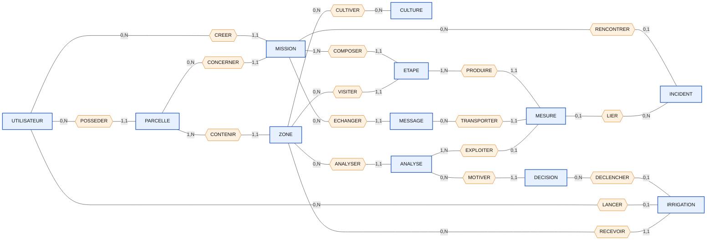
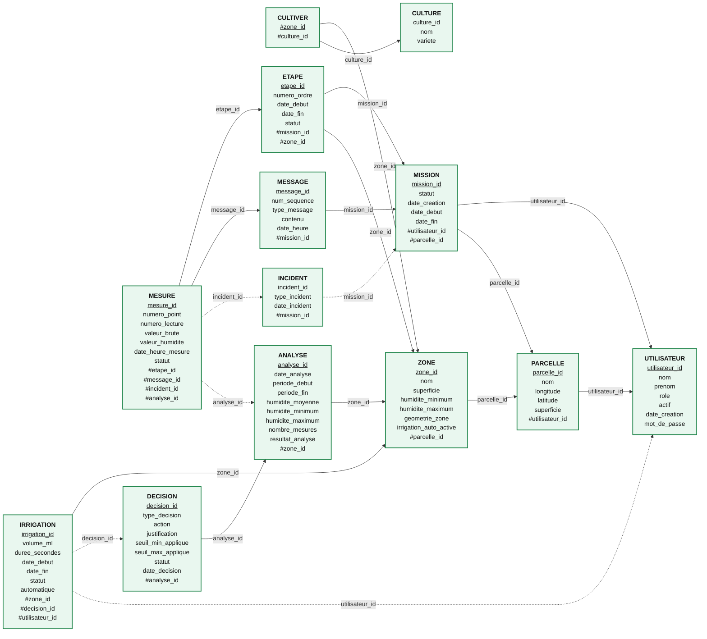
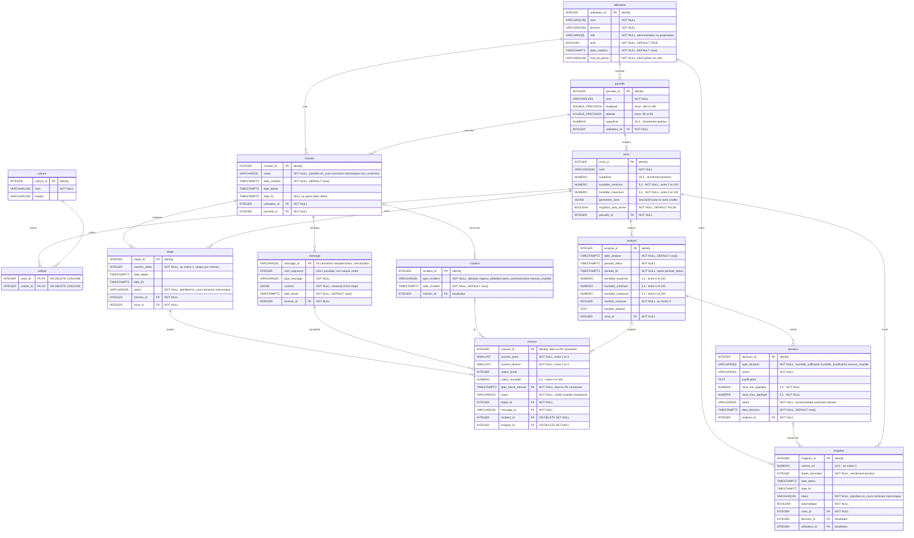

# Modèle des données — RoboAgri-Kin

Ce document contient les trois niveaux du modèle : conceptuel (MCD), logique (MLD) et physique (MPD). Le contenu est celui du document `modele_des_donnees.pdf` ; les trois schémas, qui étaient vides dans le PDF, sont dessinés en Mermaid.

**Lire les schémas** : GitHub, GitLab et VS Code (extension « Markdown Preview Mermaid Support ») affichent les blocs ` ```mermaid ` directement. Sinon, copier le contenu d'un bloc sur <https://mermaid.live> pour le voir et l'exporter en image (PNG ou SVG).

**Sommaire**

1. Modèle conceptuel des données (MCD)
2. Modèle logique des données (MLD)
3. Modèle physique des données (MPD)
4. Remarques de relecture

---

# 1. Modèle conceptuel des données (MCD)

## 1.1 Entités et attributs

| Entité | Attributs |
| --- | --- |
| UTILISATEUR | utilisateur_id, nom, prenom, role, actif, date_creation, mot_de_passe |
| PARCELLE | parcelle_id, nom, longitude, latitude, superficie |
| ZONE | zone_id, nom, superficie, humidite_minimum, humidite_maximum, geometrie_zone, irrigation_auto_active |
| CULTURE | culture_id, nom, variete |
| MISSION | mission_id, statut, date_creation, date_debut, date_fin |
| ETAPE | etape_id, numero_ordre, date_debut, date_fin, statut |
| MESSAGE | message_id, num_sequence, type_message, contenu, date_heure |
| MESURE | mesure_id, numero_point, numero_lecture, valeur_brute, valeur_humidite, date_heure_mesure, statut |
| ANALYSE | analyse_id, date_analyse, periode_debut, periode_fin, humidite_moyenne, humidite_minimum, humidite_maximum, nombre_mesures, resultat_analyse |
| DECISION | decision_id, type_decision, action, justification, seuil_min_applique, seuil_max_applique, statut, date_decision |
| INCIDENT | incident_id, type_incident, date_incident |
| IRRIGATION | irrigation_id, volume_ml, duree_secondes, date_debut, date_fin, statut, automatique |

## 1.2 Associations et cardinalités

| N° | Association | Entité 1 | Cardinalité 1 | Entité 2 | Cardinalité 2 |
| --- | --- | --- | --- | --- | --- |
| 1 | POSSEDER | UTILISATEUR | (0,N) | PARCELLE | (1,1) |
| 2 | CREER | UTILISATEUR | (0,N) | MISSION | (1,1) |
| 3 | CONTENIR | PARCELLE | (1,N) | ZONE | (1,1) |
| 4 | CONCERNER | PARCELLE | (0,N) | MISSION | (1,1) |
| 5 | CULTIVER | ZONE | (0,N) | CULTURE | (0,N) |
| 6 | COMPOSER | MISSION | (1,N) | ETAPE | (1,1) |
| 7 | VISITER | ZONE | (0,N) | ETAPE | (1,1) |
| 8 | PRODUIRE | ETAPE | (1,N) | MESURE | (1,1) |
| 9 | ECHANGER | MISSION | (0,N) | MESSAGE | (1,1) |
| 10 | TRANSPORTER | MESSAGE | (0,N) | MESURE | (1,1) |
| 11 | RENCONTRER | MISSION | (0,N) | INCIDENT | (0,1) |
| 12 | LIER | MESURE | (0,1) | INCIDENT | (0,N) |
| 13 | ANALYSER | ZONE | (0,N) | ANALYSE | (1,1) |
| 14 | EXPLOITER | ANALYSE | (1,N) | MESURE | (0,1) |
| 15 | MOTIVER | ANALYSE | (0,N) | DECISION | (1,1) |
| 16 | DECLENCHER | DECISION | (0,N) | IRRIGATION | (0,1) |
| 17 | LANCER | UTILISATEUR | (0,N) | IRRIGATION | (0,1) |
| 18 | RECEVOIR | ZONE | (0,N) | IRRIGATION | (1,1) |

Chaque cardinalité se lit du côté de l'entité qui la porte : la cardinalité 1 est celle de l'entité 1 dans l'association, la cardinalité 2 celle de l'entité 2. Exemple : dans POSSEDER, un utilisateur possède de 0 à N parcelles (0,N), et une parcelle est possédée par exactement un utilisateur (1,1).

## 1.3 Schéma du MCD

Les entités sont les rectangles bleus, les associations les hexagones orange, et chaque lien porte sa cardinalité. Les attributs de chaque entité sont dans le tableau 1.1.



## 1.4 Règles de gestion

- **RG1** : Une parcelle appartient à un seul utilisateur. Un utilisateur, comme un administrateur, peut n'en posséder aucune.
- **RG2** : Une parcelle contient au moins une zone. Chaque zone appartient à une seule parcelle.
- **RG3** : Une zone peut avoir zéro, une ou plusieurs cultures. Une culture peut être présente dans plusieurs zones.
- **RG4** : Une mission est créée par un seul utilisateur et concerne une seule parcelle.
- **RG5** : Une mission comporte au moins une étape. Chaque étape concerne une seule zone, qui appartient à la parcelle de la mission.
- **RG6** : Une zone peut être visitée plusieurs fois pendant une mission, sans prélèvement supplémentaire.
- **RG7** : Une étape prévoit 3 points de collecte, avec 3 lectures par point, soit 9 mesures. Une mesure est identifiée par son étape, son numéro de point et son numéro de lecture.
- **RG8** : Une mesure peut être valide, invalide ou manquante. Elle est enregistrée avec son statut.
- **RG9** : Un message appartient à une mission. Son contenu (JSON) regroupe toutes les mesures d'une étape. Une mesure vient d'un seul message.
- **RG10** : Le num_sequence d'un message empêche d'enregistrer deux fois la même opération.
- **RG11** : Un incident est rattaché à une mission au maximum. Il peut concerner plusieurs mesures. Une mesure est liée à un incident au maximum.
- **RG12** : Une analyse concerne une zone et exploite plusieurs mesures.
- **RG13** : Une décision est issue d'une analyse. Les seuils appliqués sont copiés depuis la zone au moment de la décision.
- **RG14** : Une irrigation concerne une zone.
- **RG15** : Si automatique est vrai, l'irrigation est liée à une décision, sans utilisateur, et la zone doit avoir irrigation_auto_active à vrai.
- **RG16** : Si automatique est faux, l'irrigation est lancée par un utilisateur, sans décision.
- **RG17** : Une mesure invalide ou un capteur défaillant interdit l'irrigation automatique et crée un incident.
- **RG18** : Chaque irrigation a une durée limitée par un maximum fixé dans l'application.

---

# 2. Modèle logique des données (MLD)

## 2.1 Schéma relationnel

Notation : la clé primaire est en **gras** (à souligner dans le schéma), les clés étrangères sont précédées de `#`.

- UTILISATEUR (**utilisateur_id**, nom, prenom, role, actif, date_creation, mot_de_passe)
- PARCELLE (**parcelle_id**, nom, longitude, latitude, superficie, #utilisateur_id)
- ZONE (**zone_id**, nom, superficie, humidite_minimum, humidite_maximum, geometrie_zone, irrigation_auto_active, #parcelle_id)
- CULTURE (**culture_id**, nom, variete)
- CULTIVER (**#zone_id**, **#culture_id**)
- MISSION (**mission_id**, statut, date_creation, date_debut, date_fin, #utilisateur_id, #parcelle_id)
- ETAPE (**etape_id**, numero_ordre, date_debut, date_fin, statut, #mission_id, #zone_id)
- MESSAGE (**message_id**, num_sequence, type_message, contenu, date_heure, #mission_id)
- INCIDENT (**incident_id**, type_incident, date_incident, #mission_id)
- MESURE (**mesure_id**, numero_point, numero_lecture, valeur_brute, valeur_humidite, date_heure_mesure, statut, #etape_id, #message_id, #incident_id, #analyse_id)
- ANALYSE (**analyse_id**, date_analyse, periode_debut, periode_fin, humidite_moyenne, humidite_minimum, humidite_maximum, nombre_mesures, resultat_analyse, #zone_id)
- DECISION (**decision_id**, type_decision, action, justification, seuil_min_applique, seuil_max_applique, statut, date_decision, #analyse_id)
- IRRIGATION (**irrigation_id**, volume_ml, duree_secondes, date_debut, date_fin, statut, automatique, #zone_id, #decision_id, #utilisateur_id)

## 2.2 Tableau des clés étrangères

| Table | Clé étrangère | Table référencée | Obligatoire |
| --- | --- | --- | --- |
| PARCELLE | utilisateur_id | UTILISATEUR | Oui |
| ZONE | parcelle_id | PARCELLE | Oui |
| CULTIVER | zone_id | ZONE | Oui (clé primaire) |
| CULTIVER | culture_id | CULTURE | Oui (clé primaire) |
| MISSION | utilisateur_id | UTILISATEUR | Oui |
| MISSION | parcelle_id | PARCELLE | Oui |
| ETAPE | mission_id | MISSION | Oui |
| ETAPE | zone_id | ZONE | Oui |
| MESSAGE | mission_id | MISSION | Oui |
| INCIDENT | mission_id | MISSION | Non |
| MESURE | etape_id | ETAPE | Oui |
| MESURE | message_id | MESSAGE | Oui |
| MESURE | incident_id | INCIDENT | Non |
| ANALYSE | zone_id | ZONE | Oui |
| MESURE | analyse_id | ANALYSE | Oui |
| DECISION | analyse_id | ANALYSE | Oui |
| IRRIGATION | zone_id | ZONE | Oui |
| IRRIGATION | decision_id | DECISION | Non |
| IRRIGATION | utilisateur_id | UTILISATEUR | Non |

> **Remarque** : la ligne `MESURE / analyse_id` indique « Oui », alors que le MCD (EXPLOITER : MESURE (0,1)) et le MPD (`ON DELETE SET NULL`) en font un lien **facultatif**. Voir la remarque 1 en fin de document. Le schéma ci-dessous suit le MCD et le MPD.

## 2.3 Schéma du MLD

Chaque rectangle est une table : la clé primaire est soulignée, les clés étrangères sont précédées de `#`. Une flèche pleine va d'une table vers la table qu'elle référence (clé étrangère obligatoire), une flèche en pointillés indique une clé étrangère facultative. Chaque flèche porte le nom de la colonne.



---

# 3. Modèle physique des données (MPD)

## 3.1 Conventions

- Noms de tables et de colonnes en français, sans accents, en minuscules avec des tirets bas.
- Clés primaires : `INTEGER GENERATED ALWAYS AS IDENTITY`.
- Dates et heures : `TIMESTAMPTZ`. Pourcentages d'humidité : `NUMERIC(5,2)`. Textes courts : `VARCHAR(n)`. Textes libres : `TEXT`.
- Suppressions : `ON DELETE RESTRICT` par défaut, pour garder la traçabilité. Exceptions : `CASCADE` sur `cultiver`, `SET NULL` sur les liens facultatifs de `mesure`.

## 3.2 Tables

### utilisateur

| Colonne | Type | Contraintes |
| --- | --- | --- |
| utilisateur_id | INTEGER | PK, identity |
| nom | VARCHAR(100) | NOT NULL |
| prenom | VARCHAR(100) | NOT NULL |
| role | VARCHAR(30) | NOT NULL, CHECK dans (administrateur, proprietaire) |
| actif | BOOLEAN | NOT NULL, DEFAULT TRUE |
| date_creation | TIMESTAMPTZ | NOT NULL, DEFAULT now() |
| mot_de_passe | VARCHAR(128) | NOT NULL (hash, jamais en clair) |

### parcelle

| Colonne | Type | Contraintes |
| --- | --- | --- |
| parcelle_id | INTEGER | PK, identity |
| nom | VARCHAR(100) | NOT NULL |
| longitude | DOUBLE PRECISION | CHECK entre -180 et 180 |
| latitude | DOUBLE PRECISION | CHECK entre -90 et 90 |
| superficie | NUMERIC(10,2) | CHECK > 0 |
| utilisateur_id | INTEGER | FK → utilisateur, NOT NULL |

### zone

| Colonne | Type | Contraintes |
| --- | --- | --- |
| zone_id | INTEGER | PK, identity |
| nom | VARCHAR(100) | NOT NULL |
| superficie | NUMERIC(10,2) | CHECK > 0 |
| humidite_minimum | NUMERIC(5,2) | NOT NULL, CHECK entre 0 et 100 |
| humidite_maximum | NUMERIC(5,2) | NOT NULL, CHECK entre 0 et 100 |
| geometrie_zone | JSONB | GeoJSON de la zone (carte Leaflet) |
| irrigation_auto_active | BOOLEAN | NOT NULL, DEFAULT FALSE |
| parcelle_id | INTEGER | FK → parcelle, NOT NULL |

Contrainte de table : `CHECK (humidite_minimum < humidite_maximum)`.

### culture

| Colonne | Type | Contraintes |
| --- | --- | --- |
| culture_id | INTEGER | PK, identity |
| nom | VARCHAR(100) | NOT NULL |
| variete | VARCHAR(100) | |

### cultiver

| Colonne | Type | Contraintes |
| --- | --- | --- |
| zone_id | INTEGER | FK → zone, ON DELETE CASCADE |
| culture_id | INTEGER | FK → culture, ON DELETE CASCADE |

Clé primaire composée : (zone_id, culture_id).

### mission

| Colonne | Type | Contraintes |
| --- | --- | --- |
| mission_id | INTEGER | PK, identity |
| statut | VARCHAR(20) | NOT NULL, CHECK dans (planifiee, en_cours, terminee, interrompue, non_confirmee) |
| date_creation | TIMESTAMPTZ | NOT NULL, DEFAULT now() |
| date_debut | TIMESTAMPTZ | |
| date_fin | TIMESTAMPTZ | |
| utilisateur_id | INTEGER | FK → utilisateur, NOT NULL |
| parcelle_id | INTEGER | FK → parcelle, NOT NULL |

Contrainte de table : `CHECK (date_fin IS NULL OR date_fin >= date_debut)`.

### etape

| Colonne | Type | Contraintes |
| --- | --- | --- |
| etape_id | INTEGER | PK, identity |
| numero_ordre | INTEGER | NOT NULL, CHECK >= 1 |
| date_debut | TIMESTAMPTZ | |
| date_fin | TIMESTAMPTZ | |
| statut | VARCHAR(20) | NOT NULL, CHECK dans (planifiee, en_cours, terminee, interrompue) |
| mission_id | INTEGER | FK → mission, NOT NULL |
| zone_id | INTEGER | FK → zone, NOT NULL |

Unicité : (mission_id, numero_ordre).

### message

| Colonne | Type | Contraintes |
| --- | --- | --- |
| message_id | VARCHAR(16) | PK, 16 caractères hexadécimaux (anti-doublon) |
| num_sequence | INTEGER | NULL possible (Last Will), non unique, sert à l'ordre |
| type_message | VARCHAR(30) | NOT NULL (valeurs à fixer avec le protocole) |
| contenu | JSONB | NOT NULL (mesures d'une étape) |
| date_heure | TIMESTAMPTZ | NOT NULL, DEFAULT now() |
| mission_id | INTEGER | FK → mission, NOT NULL |

### incident

| Colonne | Type | Contraintes |
| --- | --- | --- |
| incident_id | INTEGER | PK, identity |
| type_incident | VARCHAR(30) | NOT NULL, CHECK dans (obstacle, capteur_defaillant, perte_communication, mesure_invalide) |
| date_incident | TIMESTAMPTZ | NOT NULL, DEFAULT now() |
| mission_id | INTEGER | FK → mission, facultative |

### analyse

| Colonne | Type | Contraintes |
| --- | --- | --- |
| analyse_id | INTEGER | PK, identity |
| date_analyse | TIMESTAMPTZ | NOT NULL, DEFAULT now() |
| periode_debut | TIMESTAMPTZ | NOT NULL |
| periode_fin | TIMESTAMPTZ | NOT NULL |
| humidite_moyenne | NUMERIC(5,2) | CHECK entre 0 et 100 |
| humidite_minimum | NUMERIC(5,2) | CHECK entre 0 et 100 |
| humidite_maximum | NUMERIC(5,2) | CHECK entre 0 et 100 |
| nombre_mesures | INTEGER | NOT NULL, CHECK >= 0 |
| resultat_analyse | TEXT | |
| zone_id | INTEGER | FK → zone, NOT NULL |

Contrainte de table : `CHECK (periode_fin >= periode_debut)`.

### mesure (hypertable TimescaleDB)

| Colonne | Type | Contraintes |
| --- | --- | --- |
| mesure_id | INTEGER | identity, fait partie de la PK |
| numero_point | SMALLINT | NOT NULL, CHECK entre 1 et 3 |
| numero_lecture | SMALLINT | NOT NULL, CHECK entre 1 et 3 |
| valeur_brute | INTEGER | |
| valeur_humidite | NUMERIC(5,2) | CHECK entre 0 et 100 |
| date_heure_mesure | TIMESTAMPTZ | NOT NULL, fait partie de la PK |
| statut | VARCHAR(20) | NOT NULL, CHECK dans (valide, invalide, manquante) |
| etape_id | INTEGER | FK → etape, NOT NULL |
| message_id | VARCHAR(16) | FK → message, NOT NULL |
| incident_id | INTEGER | FK → incident, ON DELETE SET NULL |
| analyse_id | INTEGER | FK → analyse, ON DELETE SET NULL |

- Clé primaire composée : (mesure_id, date_heure_mesure).
- Unicité : (etape_id, numero_point, numero_lecture, date_heure_mesure).
- Contrainte de table : `CHECK (statut <> 'valide' OR valeur_humidite IS NOT NULL)`.

### decision

| Colonne | Type | Contraintes |
| --- | --- | --- |
| decision_id | INTEGER | PK, identity |
| type_decision | VARCHAR(30) | NOT NULL, CHECK dans (humidite_suffisante, humidite_insuffisante, mesure_invalide) |
| action | VARCHAR(50) | NOT NULL |
| justification | TEXT | |
| seuil_min_applique | NUMERIC(5,2) | NOT NULL |
| seuil_max_applique | NUMERIC(5,2) | NOT NULL |
| statut | VARCHAR(20) | NOT NULL, CHECK dans (recommandee, autorisee, refusee) |
| date_decision | TIMESTAMPTZ | NOT NULL, DEFAULT now() |
| analyse_id | INTEGER | FK → analyse, NOT NULL |

### irrigation

| Colonne | Type | Contraintes |
| --- | --- | --- |
| irrigation_id | INTEGER | PK, identity |
| volume_ml | NUMERIC(10,2) | CHECK >= 0 |
| duree_secondes | INTEGER | NOT NULL, CHECK > 0 |
| date_debut | TIMESTAMPTZ | |
| date_fin | TIMESTAMPTZ | |
| statut | VARCHAR(20) | NOT NULL, CHECK dans (planifiee, en_cours, terminee, interrompue) |
| automatique | BOOLEAN | NOT NULL |
| zone_id | INTEGER | FK → zone, NOT NULL |
| decision_id | INTEGER | FK → decision, facultative |
| utilisateur_id | INTEGER | FK → utilisateur, facultative |

Contrainte de table, qui applique RG15 et RG16 :

```sql
CHECK (
  (automatique AND decision_id IS NOT NULL AND utilisateur_id IS NULL)
  OR (NOT automatique AND utilisateur_id IS NOT NULL AND decision_id IS NULL)
)
```

## 3.3 Index

| Table | Colonnes | Usage |
| --- | --- | --- |
| mission | parcelle_id, statut | Missions d'une parcelle par statut |
| etape | mission_id | Étapes d'une mission |
| etape | zone_id | Visites d'une zone |
| message | mission_id | Messages d'une mission |
| incident | mission_id | Incidents d'une mission |
| mesure | etape_id | Mesures d'une étape |
| mesure | analyse_id | Mesures d'une analyse |
| analyse | zone_id | Analyses d'une zone |
| decision | analyse_id | Décision d'une analyse |
| irrigation | zone_id, date_debut | Historique d'irrigation d'une zone |

TimescaleDB crée déjà un index sur `date_heure_mesure`.

## 3.4 TimescaleDB

- `mesure` devient une hypertable partitionnée sur `date_heure_mesure` :

  ```sql
  SELECT create_hypertable('mesure', 'date_heure_mesure');
  ```

- La clé primaire et l'unicité incluent `date_heure_mesure`, car c'est la colonne de partitionnement.
- Aucune table ne référence `mesure` : la table `exploiter` a été supprimée et `analyse_id` est dans `mesure`.
- `mesure` peut référencer `etape`, `message`, `incident` et `analyse`, qui sont des tables ordinaires.
- L'unicité de (étape, point, lecture) ne protège plus seule contre un doublon, puisqu'elle inclut la date. Le doublon est bloqué au niveau du message par `message_id` (clé primaire), et dans le code.
- Côté Django, la clé primaire composée est à prévoir dans la migration.

## 3.5 Schéma du MPD

Chaque rectangle est une table, avec le type de chaque colonne, ses clés (`PK` clé primaire, `FK` clé étrangère) et ses contraintes principales. Les précisions de taille des `NUMERIC` sont dans le commentaire de la colonne (par exemple « 5,2 » pour `NUMERIC(5,2)`). Les liens suivent la notation « pied de corbeau » : `||` exactement un, `o|` zéro ou un, `|{` un ou plusieurs, `o{` zéro ou plusieurs.



La contrainte de table sur `irrigation` (RG15 et RG16), le `CHECK` de `zone` (`humidite_minimum < humidite_maximum`) et celui de `mesure` (une mesure `valide` a une valeur d'humidité) sont écrits en 3.2.

---

# 4. Remarques de relecture

Ces remarques viennent de la conversion du PDF en Markdown. Le contenu des sections 1 à 3 est resté identique au PDF ; rien n'a été corrigé sans vous le dire.

1. **`mesure.analyse_id`, obligatoire ou facultatif ?** Le tableau des clés étrangères du MLD (2.2) indique « Oui », alors que le MCD (EXPLOITER : MESURE (0,1)) et le MPD (`ON DELETE SET NULL`, pas de `NOT NULL`) en font un lien facultatif. Une mesure est créée avant son analyse, donc le lien est facultatif : la ligne du tableau 2.2 devrait dire « Non ».
2. **RG10** dit que `num_sequence` empêche d'enregistrer deux fois la même opération. Le MPD (3.2 et 3.4) et le protocole de communication confient l'anti-doublon à `message_id` (clé primaire) ; `num_sequence` ne sert qu'à l'ordre (« non unique »). La formulation de RG10 est à mettre à jour.
3. **`message.type_message`** : le MPD dit « valeurs à fixer avec le protocole ». Le protocole de communication (version 1.1) les fixe : `mission_recue`, `etape_atteinte`, `mesure`, `changement_etat`, `incident`. Un `CHECK` peut être ajouté.
4. **Connexion des utilisateurs** : la table `utilisateur` n'a pas d'`email`, alors que le backend s'en sert comme identifiant de connexion. Si ce choix est retenu, le champ (unique, obligatoire) est à ajouter au MCD, au MLD et au MPD.
5. **Schémas** : le MCD est un diagramme Mermaid « entités, associations, cardinalités » sans attributs dans les rectangles (ils sont en 1.1). Si le rapport impose la notation Merise classique (entités avec attributs soulignés), le schéma est à redessiner dans l'outil du groupe (draw.io, JMerise ou autre) à partir des tableaux 1.1 et 1.2.