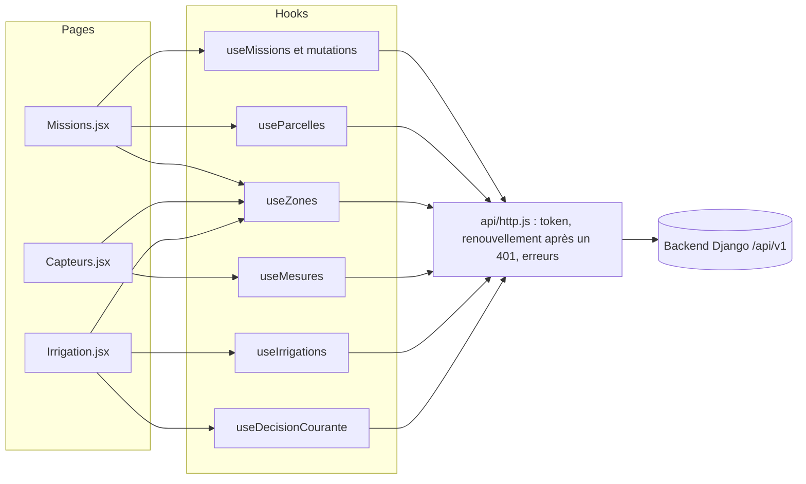

# Frontend : chemin d'une donnée (page → hook → API → backend)

Pour les pages Missions, Capteurs et Irrigation : par quels fichiers passe une donnée entre l'écran et le backend Django.

## Schéma

## Rôle de chaque couche

| Couche | Rôle |
|---|---|
| Page | Affiche les données et réagit aux clics. Ne parle jamais directement au backend. |
| Hook | `useQuery` (lecture) ou `useMutation` (écriture) de TanStack Query. Porte la clé de requête, le polling et l'invalidation. |
| `api/http.js` | Ajoute le token, renouvelle la session après un 401, transforme les erreurs en `ErreurApi`. |
| Backend | Django REST Framework, préfixe `/api/v1/`. |

Réglages communs (`api/queryClient.js`) : données considérées fraîches 30 s, pas de rechargement au retour sur l'onglet, un seul nouvel essai sauf pour les erreurs 401, 403 et 404.

## Page Missions

| Hook | Clé de requête | Appel | Format supposé par la page | Rafraîchissement |
|---|---|---|---|---|
| `useMissions()` | `['missions','liste',{}]` | GET `/missions/` | tableau brut | aucun |
| `useParcelles()` | `['parcelles','liste']` | GET `/parcelles/` | tableau brut (zones incluses) | aucun |
| `useZones({parcelle})` | `['zones','liste',{parcelle}]` | GET `/zones/?parcelle=ID` | tableau brut | aucun |
| `useCreerMission()` | mutation | POST `/missions/` avec `{parcelle, utilisateur, etapes:[{numero_ordre, zone}]}` | n/a | invalide `['missions']` |
| `useDemarrerMission(id)` | mutation | POST `/missions/{id}/demarrer/` | n/a | invalide `['missions']` |
| `useTerminerMission(id)` | mutation | POST `/missions/{id}/terminer/` | n/a | invalide `['missions']` |
| `useInterrompreMission(id)` | mutation | POST `/missions/{id}/interrompre/` | n/a | invalide `['missions']` |

`useMission(id)` (polling 3 s tant que la mission n'est pas finale) existe mais aucune page ne l'utilise encore : il servira à DetailMission.

## Page Capteurs

| Hook | Clé de requête | Appel | Format supposé par la page | Rafraîchissement |
|---|---|---|---|---|
| `useMesures({statut:'valide', polling:true})` | `['mesures','liste',{...}]` | GET `/mesures/?statut=valide` | paginé (`results`) | 3 s |
| `useZones()` | `['zones','liste',{}]` | GET `/zones/` | tableau brut | aucun |

## Page Irrigation

| Hook | Clé de requête | Appel | Format supposé par la page | Rafraîchissement |
|---|---|---|---|---|
| `useZones()` | `['zones','liste',{}]` | GET `/zones/` | tableau brut | aucun |
| `useDecisionCourante(zoneId)` | à compléter | à compléter | à compléter | à compléter |
| `useIrrigations()` | `['irrigations','liste',{zone,statut}]` | GET `/irrigations/` | paginé (`results`) | aucun |
| `useModifierSeuilsZones()` | mutation | PATCH `/zones/{id}/` (un appel par zone modifiée) avec `{humidite_minimum, humidite_maximum}` | n/a | invalide zones et parcelles |
| `useCreerIrrigation()` | mutation | POST `/irrigations/` avec `{zone, duree_secondes}` (403 = arrosage refusé) | n/a | invalide irrigations et décisions |

## À vérifier au contrat d'API

- La colonne « format supposé » est ce que la page attend, pas ce qui a été vérifié. À confirmer en appelant chaque adresse.
- `useMesures` est désactivé (`enabled`) tant qu'on ne lui donne ni mission ni zone : l'appel de Capteurs part-il vraiment ?
- `useMissions(filtres)` met les filtres dans la clé mais ne les envoie pas au backend.
- `useSeuilsZones` (GET `/irrigations/seuils/`) n'est utilisé par aucune page.
- `api/client.js` et `api/missions.js` ne sont plus utilisés : à supprimer.